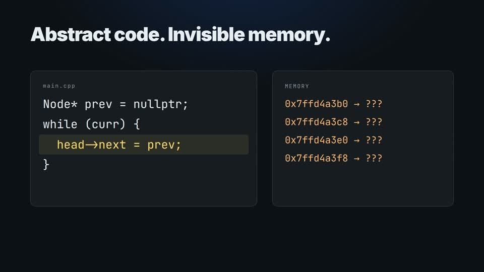

# SimIDE (Simulation + IDE)

<p align="center">
  
</p>

[](file:///c:/Projects/vscode-extension/test/runAll.js)
[](https://marketplace.visualstudio.com/)
[](https://isocpp.org/)
[](file:///c:/Projects/vscode-extension/LICENSE)
[](file:///c:/Projects/vscode-extension/docs/README.md)

> **SimIDE — Real-time C++ debugging and interactive Data Structures & Algorithms (DSA) simulation directly in your Visual Studio Code sidebar.**

**SimIDE** (*Simulation + IDE*) helps students, educators, and developers master C++ memory management and pointer-based data structures. As you step through your code, SimIDE dynamically watches the running program, extracts heap state across function calls, and renders an interactive, physics-driven canvas with plain English explanations for every pointer assignment, traversal, deletion, and terminal output.

This is a **real developer tool** connected directly to native GDB/LLDB via VS Code's Debug Adapter Protocol (DAP)—not a pre-recorded animation, disconnected simulation, or static mockup.

---

## Launch Demo

[](docs/media/simide-launch.mp4)

[Watch or download the launch video](docs/media/simide-launch.mp4).

## Table of Contents

- [Launch Demo](#launch-demo)
- [Why SimIDE?](#why-simide)
- [Key Features](#key-features)
- [Supported C++ Paradigms & Algorithms](#supported-c-paradigms--algorithms)
- [Architecture Overview](#architecture-overview)
- [Quick Start](#quick-start)
- [Prerequisites](#prerequisites)
- [Installation & Setup](#installation--setup)
- [Usage Walkthrough](#usage-walkthrough)
- [Sample Programs Library](#sample-programs-library)
- [Visual Design System & Physics Canvas](#visual-design-system--physics-canvas)
- [Testing & Verification](#testing--verification)
- [FAQ & Troubleshooting](#faq--troubleshooting)
- [Roadmap](#roadmap)
- [Contributing](#contributing)
- [License](#license)
- [Contact](#contact)

---

## Why SimIDE?

Learning pointer-based data structures in C++ is notoriously challenging:
- Raw memory addresses like `0x74a3b0` and `0x74a3f0` in the debugger's variable pane are difficult to mentally map into a linked chain.
- Learners often confuse **heap allocation** (`new Node{10, nullptr}`) with **linking** (`head = first;` or `first->next = second;`).
- Algorithm reversals (e.g., LeetCode 206) and memory deallocations (`delete temp;`) happen silently under the hood without visual feedback.
- Disconnected browser simulators force students to copy and paste code away from their real IDE, losing access to language servers and compiler diagnostics.

**SimIDE solves this right inside VS Code**:
1. You write standard C++ code in your normal editor.
2. Click **[ Visualize ]** in the SimIDE sidebar.
3. The extension compiles your code with debug flags (`-g -O0 -std=c++17`), launches GDB/LLDB, captures state upon every step across function calls, emulates live terminal output, and renders interactive diagrams with pedagogical teaching explanations.

---

## Key Features

- **Genuine Debugger Execution**: Runs real native C++ binaries using VS Code's Debug Adapter Protocol (DAP). Stepping in SimIDE advances the actual C++ program and highlights the live source line in the VS Code editor.
- **Dynamic Pointer Discovery**: Discovers any pointer variables in your code dynamically via source regex and line thresholds—supporting arbitrary variable names without hardcoding!
- **Pointer Traversal & Function Stepping**: Follows execution seamlessly into helper functions (like `printList(Node* head)` or `reverseList(ListNode* head)`), highlighting pointer movements (`curr = curr->next`) node-by-node.
- **Node Deletion & Bypassing**: Detects heap deallocations (`delete temp;`) and unlinking, visually fading out and removing deleted nodes while explaining pointer bypasses.
- **Live Program Output Terminal**: Emulates `std::cout` and `printf` in real time within a dedicated terminal card in the sidebar.
- **Pointer Aliasing Tracking**: Visually flags when multiple pointers refer to the same heap node (e.g., `head` aliasing `first` at `0x74a3b0`).
- **Spring-Damper Physics Canvas**: Powered by a hybrid physics engine (integrated with `d3-force`). Nodes behave as physical bodies connected by elastic springs with natural recoil and repulsion.
- **Excalidraw-Style Infinite Pan & Zoom**: Navigate complex structures with Right-Click Pan, Mouse Wheel Zoom (0.35x to 2.5x), Spacebar drag, double-click reset, and a quick `↺ Reset` layout button—with zero clunky scrollbars!
- **Detached Allocation Tracking**: Uniquely tracks local unlinked node allocations before they are linked into `head`, helping students visualize the moment memory is allocated versus when it is connected.
- **C Runtime (CRT) Boundary Protection**: Detects when execution reaches `return 0;` or C runtime exit routines, cleanly finishing execution and preserving the completed linked list diagram without flickering.
- **Binary Search Tree (BST) Simulation**: Automatic tree mode detection, calculating in-order horizontal layout columns and depth levels, and animating active visiting nodes during traversals.
- **Seamless Multi-File Switching**: Effortlessly switch between different C++ files (e.g., from linked lists to BSTs); SimIDE automatically tracks the active file, compiles the correct file, and eliminates tab-switch hijacking.
- **Zero-Distraction Debugging**: Automatically suppresses internal debug console popups, build task terminals, and third-party AI sidebars, keeping your workspace clean.
- **Non-Destructive Time Travel**: Review past states by clicking **Previous** without terminating or corrupting the running C++ process. Step forward again to seamlessly resume live debugging.

---

## Supported C++ Paradigms & Algorithms

SimIDE is tested and verified on real-world C++ patterns:

1. **Standard Procedural Code**: Creation, pointer reassignment, and iterative traversals ([`examples/linked-list.cpp`](file:///c:/Projects/vscode-extension/examples/linked-list.cpp)).
2. **LeetCode Problems**: Three-pointer in-place reversals (`prev`, `curr`, `forward`) using standard `ListNode` structures ([`examples/leetcode-206-reverse.cpp`](file:///c:/Projects/vscode-extension/examples/leetcode-206-reverse.cpp)).
3. **GeeksforGeeks Patterns**: Double pointer references (`Node** head_ref`) and key deletion with heap memory management (`delete temp`) ([`examples/gfg-push-delete.cpp`](file:///c:/Projects/vscode-extension/examples/gfg-push-delete.cpp)).
4. **Object-Oriented Programming (OOP)**: Encapsulated linked lists with C++ classes, member methods (`insertAtHead`, `display`), and `this` pointer resolution ([`examples/oop-linked-list.cpp`](file:///c:/Projects/vscode-extension/examples/oop-linked-list.cpp)).
5. **Binary Search Trees (BST)**: Dynamic tree root tracking, insertion, in-order/pre-order/post-order traversals, visiting node highlighting, and Case A deletion (leaf & single-child nodes) ([`examples/bst-traversals.cpp`](file:///c:/Projects/vscode-extension/examples/bst-traversals.cpp)).

---

## Architecture Overview

SimIDE coordinates four decoupled subsystems across process boundaries:

```
+-------------------------------------------------------------------------+
|                        VS CODE EXTENSION HOST                           |
|                                                                         |
|  [src/extension.ts] ──▶ [LinkedListViewProvider] (Sidebar Webview Hub)  |
|                                │                                        |
|         ┌──────────────────────┼──────────────────────┐                 |
|         ▼                      ▼                      ▼                 |
|  [src/debug/]           [src/visualization/]     [webview/app.ts]       |
|  • CppCompiler          • LinkedListModel        • Spring Physics Engine|
|  • DebugSessionManager  • ExplanationGenerator   • Pan & Zoom Camera    |
|  • DebugAdapterTracker  • SnapshotManager        • SVG Dynamic Arrows   |
|  • ExecutionController  • Pointer Models         • Dot-Grid Canvas      |
|  • StateExtractor       • Terminal Output        • Live Terminal Output |
+---------│─────────────────────────────────────────────▲-----------------+
          │ (DAP Protocol)                              │ (Typed IPC)
          ▼                                             │
+───────────────────────+                     +──────────────────+
| Native GDB / LLDB     |                     | Sidebar Webview  |
| (Real C++ Process)    |                     | (Chromium View)  |
+───────────────────────+                     +──────────────────+
```

### Complete Documentation

For comprehensive technical deep-dives, please explore the [`docs/`](file:///c:/Projects/vscode-extension/docs/README.md) directory:
- **[System Architecture](file:///c:/Projects/vscode-extension/docs/architecture.md)**: Process boundaries, DAP wire protocol, dynamic pointer discovery, and CRT protection.
- **[Component Deep-Dive](file:///c:/Projects/vscode-extension/docs/components.md)**: Module-by-module breakdown of all source files.
- **[Data Flow & Lifecycles](file:///c:/Projects/vscode-extension/docs/data-flow.md)**: Sequence diagrams for launch, stepping, physics loop, terminal output, and time-travel.
- **[AI Agent Guide](file:///c:/Projects/vscode-extension/docs/agent-guide.md)**: Developer guide for automated agents and contributors adding new data structures.

---

## Quick Start

```bash
# 1. Clone the repository
git clone https://github.com/KingSahil/Simide.git
cd Simide

# 2. Install dependencies
npm install

# 3. Build the extension and webview bundles
npm run compile

# 4. Run the automated test suite (verifies GCC, LeetCode reversal & GDB stepping)
npm test
```

To launch and test the extension interactively in VS Code:
1. Open the project folder in VS Code (`code .`).
2. Press `F5` to open the **Extension Development Host**.
3. Open `examples/linked-list.cpp`.
4. Click the **SimIDE** icon in the Activity Bar.
5. Click **[ Visualize ]** and step through your code!

---

## Prerequisites

Before running the extension, verify your system has the following tools installed:

1. **Visual Studio Code**: `v1.85.0` or higher.
2. **C++ Compiler**: `g++` (MinGW-w64 on Windows, GCC on Linux) or `clang++` accessible in system `PATH`.
3. **Debugger**: `gdb` or `lldb` accessible in system `PATH`.
4. **C/C++ Extension**: [`ms-vscode.cpptools`](https://marketplace.visualstudio.com/items?itemName=ms-vscode.cpptools) installed in VS Code.
5. **Node.js**: `v18+` (tested on Node `v20` and `v26`).

---

## Installation & Setup

### Building from Source

```bash
# Install Node dependencies (includes d3-force physics)
npm install

# Build bundles via esbuild
npm run compile
```

### Packaging into a VSIX Extension (Optional)

```bash
npx @vscode/vsce package
```
This generates `simide-ide-0.1.1.vsix`, matching the version in `package.json`, which can be installed into Visual Studio Code using:
```bash
code --install-extension simide-ide-0.1.1.vsix
```

---

## Usage Walkthrough

SimIDE includes a complete singly linked list sample with traversal in [`examples/linked-list.cpp`](file:///c:/Projects/vscode-extension/examples/linked-list.cpp):

```cpp
#include <iostream>

struct Node {
    int data;
    Node* next;
};

// Traversal Function
void printList(Node* head) {
    Node* current = head;
    while (current != nullptr) {
        std::cout << current->data << " -> ";
        current = current->next;
    }
    std::cout << "NULL\n";
}

int main() {
    // 1. Create 3 isolated nodes
    Node* head = new Node{10, nullptr};
    Node* second = new Node{20, nullptr};
    Node* third = new Node{30, nullptr};

    // 2. Link them together
    head->next = second;
    second->next = third;

    // 3. Traverse and display
    printList(head);

    return 0;
}
```

### Step-by-Step Experience

1. **Open File**: Open `examples/linked-list.cpp` in the editor.
2. **Open Sidebar**: Click the **SimIDE** icon in the VS Code Activity Bar.
3. **Click Visualize**: Click the large blue **[ Visualize ]** button.
   - The status spinner updates: *"Compiling source..."* → *"Starting debugger..."*.
4. **Allocation**:
   - As `new Node{10, nullptr}` executes, node 10 is created on the canvas.
   - Nodes `20` and `30` appear in the detached area as they allocate.
5. **Linking**:
   - `head->next = second;` dynamically links node 10 to node 20 with spring physics.
   - `second->next = third;` forms the full chain: `head ──▶ [ 10 | • ] ──▶ [ 20 | • ] ──▶ [ 30 | • ] ──▶ nullptr`.
6. **Function Stepping & Traversal**:
   - Step into `printList(head)`.
   - Watch the `current` pointer badge traverse from node 10 to node 20 to node 30!
   - The **Program Output** terminal card live-streams the output: `10 -> 20 -> 30 -> NULL`.
7. **Time Travel**: Click **[ Previous ]** to rewind back through past states and inspect earlier pointer assignments.

---

## Sample Programs Library

Explore our ready-to-run C++ programs in [`examples/`](file:///c:/Projects/vscode-extension/examples/):

| File | Category | Key Concept Highlighted |
| :--- | :--- | :--- |
| **[`linked-list.cpp`](file:///c:/Projects/vscode-extension/examples/linked-list.cpp)** | Basic / Traversal | Allocation, linking, and `printList` traversal with terminal output. |
| **[`leetcode-206-reverse.cpp`](file:///c:/Projects/vscode-extension/examples/leetcode-206-reverse.cpp)** | LeetCode 206 | In-place iterative pointer reversal (`prev`, `curr`, `forward`). |
| **[`gfg-push-delete.cpp`](file:///c:/Projects/vscode-extension/examples/gfg-push-delete.cpp)** | GeeksforGeeks | Double pointers (`Node** head_ref`) and heap memory freeing (`delete`). |
| **[`oop-linked-list.cpp`](file:///c:/Projects/vscode-extension/examples/oop-linked-list.cpp)** | OOP C++ | `class LinkedList`, member methods, and `this` pointer resolution. |
| **[`bst-traversals.cpp`](file:///c:/Projects/vscode-extension/examples/bst-traversals.cpp)** | Binary Search Tree | BST insertion, traversals, visiting indicators, and Case A deletion (leaf/single-child). |

---

## Visual Design System & Physics Canvas

The user interface uses a curated, high-contrast dark theme designed to blend seamlessly with VS Code:

| Design Token | Color Value | Purpose |
| :--- | :--- | :--- |
| `--bg-primary` | `#0D1117` | Main sidebar and editor-adjacent surface |
| `--bg-sidebar` | `#11161D` | Sidebar view container base |
| `--bg-card` | `#151B23` | Diagram, terminal, and explanation cards |
| `--bg-elevated` | `#1C232D` | Secondary pill buttons, step chips, and badges |
| `--border-color` | `#2A3441` | Card outlines and node boundaries |
| `--text-primary` | `#F5F7FA` | Primary labels, headers, and node values |
| `--text-secondary`| `#A7B0BC` | Pedagogical explanations and step numbers |
| `--text-muted` | `#737D8C` | Null indicators (`nullptr`) and drag hints |
| `--accent` | `#0066FF` | Primary button, active SVG arrows, and node focus |
| `--accent-tint` | `#142B4D` | Highlighted node backgrounds |
| `--success` | `#36C779` | Paused status indicator, detached nodes, and completion badge |
| `--danger` | `#F85149` | Error state indicators and diagnostic alerts |

---

## Testing & Verification

SimIDE includes a comprehensive automated test suite with headless GDB integration:

```bash
npm test
```

### Verified Test Matrix

| Test Suite | Description | Result |
| :--- | :--- | :--- |
| **Test 1: Compiler Detection** | Detects MinGW `g++` / Clang in system PATH | **PASSED** |
| **Test 2: Debugger Discovery** | Locates `gdb.exe` binary | **PASSED** |
| **Test 3: Pedagogical Engine** | Verifies explanations for creation, linking, deletion, traversal & output | **PASSED** |
| **Test 4: Snapshot History** | Verifies non-destructive `prev()` and `nextHistory()` time travel | **PASSED** |
| **Test 5: Robust Pointer Parsing** | Verifies runtime pointer parsing and source discovery across LeetCode, GFG, and OOP examples | **PASSED** |
| **Test 6: Compilation Matrix** | Compiles `leetcode-206-reverse.cpp`, `gfg-push-delete.cpp`, `oop-linked-list.cpp`, and `bst-traversals.cpp` | **PASSED** |
| **Test 7: Real GDB Stepping** | Steps through C++ binary line-by-line and validates runtime values | **PASSED** |
| **Test 8: Real GDB LeetCode Reversal** | Verifies real runtime execution of in-place reversal (3 → 2 → 1) | **PASSED** |
| **Test 9: Real GDB BST Traversals** | Verifies BST runtime stops, tree pointer chasing, and Case A deletions | **PASSED** |

`npm run compile` runs TypeScript checking before bundling. The test suite also
checks simulation startup, visible initialization errors, retry, and real GDB
execution of `examples/array-operations.cpp` (update, swap, and traversal).

Source discovery currently uses the restored regex implementation. The Clang AST
parser is present as an unintegrated module; the full AST migration is unfinished.
Runtime values and pointer addresses come from the debugger.

For the array demo, open `examples/array-operations.cpp` in the Extension Development
Host, open SimIDE, and click **Visualize**. Step through the initialization, set
`arr[2]` to `99`, swap the first two elements, and traverse the array. The output
should be `20 10 99 40 50`. **Previous** reviews saved snapshots; it does not reverse
the executing C++ program. F5 in this repository launches the development host;
it does not itself start the visualization.

---

## FAQ & Troubleshooting

### Why does the compiler need the `-O0` flag?
Compiler optimization levels (`-O1`, `-O2`, `-O3`) optimize away temporary pointer variables (like `curr` or `prev`) into registers or inline them entirely. Compiling with `-O0` ensures every variable exists in stack memory so the debugger can inspect it.

### Can I step through my own custom functions?
Yes! SimIDE dynamically discovers user-defined functions (such as `printList`, `reverseList`, `push`, `deleteNode`, and class methods) and tracks pointer movements and variable scopes as execution steps into them.

### Can I pan and zoom the diagram?
Yes! Use **Right-Click Drag**, **Middle-Click Drag**, or **Space + Left-Click Drag** to pan. Use the **Mouse Wheel** to zoom in or out. Double-click the background or click `↺ Reset` to re-center.

### What should I do if compilation fails with `EBUSY` on Windows?
On Windows, a running debugger locks the output `.exe`. SimIDE automatically detects locked files and compiles to an alternate timestamped executable (e.g. `linked-list_1792051440937.exe`). If an issue persists, click **Restart** or close hanging GDB processes.

---

## Roadmap

- [x] **Milestone 1**: Singly Linked List visualization with GDB integration, spring-damper physics canvas, pan/zoom camera, dynamic pointer discovery, and time-travel history.
- [x] **Milestone 2**: In-place pointer reversals (LeetCode 206), heap deletions (`delete`), OOP classes, and live program output terminal.
- [ ] **Milestone 3**: Doubly Linked Lists with bidirectional SVG arrows (`prev` and `next`).
- [x] **Milestone 4**: Binary Search Trees (BST) with in-order column depth layout, preorder/inorder/postorder traversals, visiting badges, and Case A deletions.
- [ ] **Milestone 5**: Stacks and Queues with push/pop animations.
- [ ] **Milestone 6**: Memory leak detection highlighting unreferenced heap allocations that fall out of scope without `delete`.

---

## Contributing

Contributions from students, educators, and developers are warmly welcomed!

1. Fork the repository: [https://github.com/KingSahil/Simide](https://github.com/KingSahil/Simide).
2. Create a feature branch: `git checkout -b feature/doubly-linked-list`.
3. Check the **[AI Agent & Developer Guide](file:///c:/Projects/vscode-extension/docs/agent-guide.md)** for architecture guidelines and conventions.
4. Make changes and verify that `npm run compile` and `npm test` pass cleanly.
5. Commit your changes: `git commit -m 'feat: Add doubly linked list support'`.
6. Push to your branch and open a Pull Request.

---

## License

This project is licensed under the **MIT License**. See the [LICENSE](file:///c:/Projects/vscode-extension/LICENSE) file for details.

---

## Contact

- **Repository**: [https://github.com/KingSahil/Simide](https://github.com/KingSahil/Simide)
- **Issues & Bug Reports**: [GitHub Issues](https://github.com/KingSahil/Simide/issues)
- **Author & Maintainer**: Sahil ([@KingSahil](https://github.com/KingSahil))
