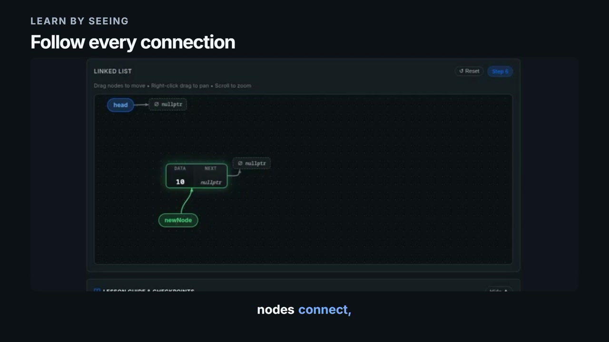
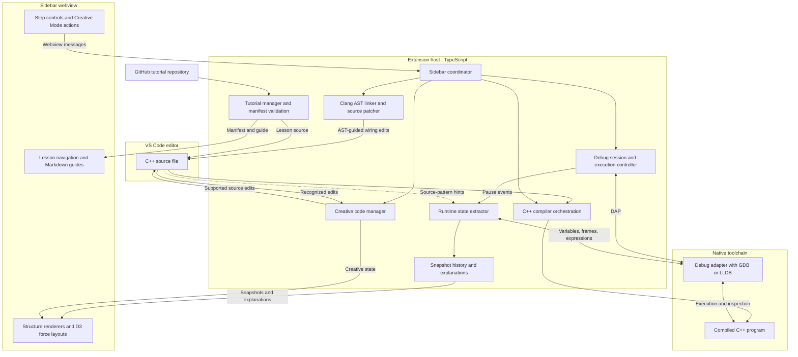

<p align="center">
  
</p>

<h1 align="center">SimIDE</h1>

<p align="center"><strong>See your code. Explore its memory. Build structures visually.</strong></p>

<p align="center">
  <a href="package.json"></a>
  <a href="#supported-data-structures"></a>
  <a href="LICENSE"></a>
  <a href="docs/README.md"></a>
</p>

**SimIDE (Simulation + IDE)** is a Visual Studio Code extension for learning data structures and algorithms through native C++ execution, interactive diagrams, and visual code creation. Step through a program, inspect how pointers and values change, or build supported structures on a canvas and see the corresponding C++ source update.

## Demo

[](https://github.com/KingSahil/Simide/blob/main/resources/demo/simide-launch.mp4)

**[Watch the launch demo](https://github.com/KingSahil/Simide/blob/main/resources/demo/simide-launch.mp4)** · 1 minute 36 seconds · 1080p · [Download MP4](https://raw.githubusercontent.com/KingSahil/Simide/main/resources/demo/simide-launch.mp4)

## Contents

- [Learning workflows](#learning-workflows)
- [Supported data structures](#supported-data-structures)
- [Getting started](#getting-started)
- [Architecture](#architecture)
- [Tutorial authoring](#tutorial-authoring)
- [Development and verification](#development-and-verification)
- [Current scope](#current-scope)
- [Roadmap](#roadmap)
- [Contributing](#contributing)

## Learning workflows

### Explore a C++ program

Open a supported, compilable C++ file, open **SimIDE** from the Activity Bar, and click **Visualize**. SimIDE compiles the source, launches a native debugger, and renders extracted state as execution advances.

- **Next** advances through execution or saved history.
- **Previous** reviews recorded snapshots; it does not reverse the running C++ process.
- **Restart** begins a new execution session.
- Step explanations connect supported allocations, mutations, traversals, and deletions with plain-English descriptions.
- A program-output panel displays supported output alongside the diagram.
- Draggable nodes, background panning, zoom, and layout reset help navigate larger structures.

Function stepping and caller-frame inspection help preserve the surrounding structure while execution moves through helper functions.

### Build in Creative Mode

Start with a blank canvas and starter C++ file. Add linked-list nodes, edit values, connect or disconnect pointers, and delete nodes. Supported stack and queue creation actions also generate C++ source.

For example, a visual connection between two nodes can produce:

```cpp
first->next = second;
```

Edits to recognized source patterns refresh the Creative Mode canvas, letting students explore code and diagrams in both directions.

### Follow a GitHub tutorial

Use the sidebar's GitHub import action or run **SimIDE: Import Tutorial from GitHub** from the Command Palette. Enter a compatible repository URL or `owner/repository`, select a lesson, and follow its Markdown guide while stepping through the program.

Tutorial repositories require a `simide.json` manifest. See the [authoring guide](docs/tutorial-authoring-guide.md) for the supported format.

## Supported data structures

| Structure | Visual concepts | Examples |
| --- | --- | --- |
| Linked lists | Allocation, aliases, linking, reversal, deletion, and supported backward links | [Linked list](examples/linked-list.cpp), [reversal](examples/leetcode-206-reverse.cpp) |
| Binary trees / BSTs | Child pointers, hierarchical layouts, and traversal highlights | [BST traversals](examples/bst-traversals.cpp) |
| Arrays | Indexed cells, mutations, swaps, and index markers | [Array operations](examples/array-operations.cpp), [bubble sort](examples/bubble-sort.cpp) |
| Stacks | Push/pop behavior, top position, and capacity | [Stack operations](examples/stack-operations.cpp) |
| Circular queues | Front/rear positions and buffer wrap-around | [Circular queue](examples/circular-queue.cpp) |
| Graphs | Vertex-edge relationships and force-directed layouts | [Graph registry](examples/graph-registry.cpp) |
| Strings | Character tiles, ASCII values, null terminators, two-pointer movement, and window highlights | [Palindrome](examples/string-palindrome.cpp), [sliding window](examples/sliding-window-string.cpp), [C-string reversal](examples/c-string-reverse.cpp) |

Support depends on recognizable source representations and the information exposed by the debugger. The [examples](examples/) provide starting points for compatible programs.

## Getting started

### Prerequisites

| Requirement | Purpose |
| --- | --- |
| VS Code **1.85 or newer** | Extension host and sidebar |
| `g++` or `clang++` on `PATH` | Compile C++ programs with debug symbols |
| GDB or LLDB on `PATH` | Inspect native execution |
| Compatible debug adapter | C/C++ (`ms-vscode.cpptools`) is recommended; the launcher also supports Native Debug (`webfreak.debug`) and CodeLLDB (`vadimcn.vscode-lldb`) configurations |
| Node.js and npm | Build and package the extension from source |
| Clang for AST-guided wiring | Resolve source symbols and insertion ranges for the visual node-to-code linker |

On Windows, MinGW-w64 provides a common GCC/GDB toolchain. Ensure the compiler, debugger, and installed adapter are compatible.

### Run from source

```bash
git clone https://github.com/KingSahil/Simide.git
cd Simide
npm ci
npm run compile
code .
```

1. In VS Code's **Run and Debug** menu, select **Run Extension (String Demo)** or **Run Extension (Active File)**.
2. Press **F5** to open the Extension Development Host.
3. Open an example such as `examples/string-palindrome.cpp` or `examples/linked-list.cpp` in that window.
4. Open **SimIDE** from the Activity Bar and click **Visualize**.

F5 launches the development host; **Visualize** starts the C++ visualization. SimIDE generates the program's debug launch configuration.

### Install a locally built extension

```bash
npx @vscode/vsce package --no-dependencies
code --install-extension simide-ide-0.1.1.vsix
```

The filename follows the version in [package.json](package.json); replace it with the generated filename when the version changes. Reload VS Code after installation.

## Architecture

The extension host coordinates compilation, debugger inspection, source edits, and tutorials. A webview renders snapshots and sends user actions back to the host.



**Runtime visualization** uses debugger values plus source-pattern discovery. **Creative Mode** maintains a separate visual editing state and writes supported source changes. Clang AST parsing supports the visual wiring path; runtime discovery is not a complete AST-based C++ analyzer.

| Area | Main modules |
| --- | --- |
| Activation and commands | [`src/extension.ts`](src/extension.ts) |
| Sidebar coordination | [`src/sidebar/linkedListViewProvider.ts`](src/sidebar/linkedListViewProvider.ts) |
| Compilation, stepping, and inspection | [`src/debug/`](src/debug/) |
| Snapshot models and explanations | [`src/visualization/`](src/visualization/) |
| Visual editing and source wiring | [`src/creative/`](src/creative/), [`src/parser/`](src/parser/), [`edgeLinkHandler.ts`](src/sidebar/edgeLinkHandler.ts) |
| Tutorial import and validation | [`src/tutorial/`](src/tutorial/), [`src/cli/validator.ts`](src/cli/validator.ts) |
| Canvas, controls, and styling | [`webview/`](webview/) |

See the [documentation index](docs/README.md), [architecture notes](docs/architecture.md), and [data-flow guide](docs/data-flow.md) for implementation details. Some older guides describe earlier milestones; the modules above are the reference for current behavior.

## Tutorial authoring

A tutorial repository contains a root manifest and lesson files:

```text
my-tutorial/
├── simide.json
└── lessons/
    └── 01-introduction/
        ├── main.cpp
        └── guide.md
```

Follow the [tutorial authoring guide](docs/tutorial-authoring-guide.md) and [manifest schema](schemas/v1/tutorial.schema.json). After building SimIDE, validate a local tutorial directory with:

```bash
node bin/simide.js test /path/to/my-tutorial
```

The validator checks the manifest, audits source for flagged constructs, and attempts lesson compilation. Source auditing provides warnings; imported tutorials execute native code and should come from sources you trust.

## Development and verification

```bash
npm ci
npm run compile
npm test
```

`npm run compile` performs TypeScript checking and bundles the extension, webview, and CLI validator. `npm test` builds and runs regression suites for models, renderers, startup, state extraction, strings, source patching, Creative Mode, tutorials, and native GDB execution.

Native integration tests require the local compiler and debugger toolchain. For a visual change, also launch the Extension Development Host and check the affected example interactively.

## Current scope

- The primary execution workflow targets standalone C++17 programs. Judge-only snippets need a compilable entry point and any required definitions.
- Source discovery and Creative Mode synchronization recognize supported patterns; arbitrary C++ syntax and every container implementation are not covered.
- **Previous** replays saved snapshots. It does not undo memory changes in the executing process.
- Debugger behavior and available values depend on the installed toolchain and adapter. Compilation with `-O0` reduces optimization-related inspection problems.

### Troubleshooting

| Symptom | What to check |
| --- | --- |
| Compiler or debugger not found | Confirm the tools are on `PATH`, then restart VS Code so it inherits the updated environment. |
| Debug session will not launch | Check that a compatible debug adapter is installed and matches the selected GDB/LLDB toolchain. |
| Program does not compile | Start with a bundled example, then check the program's entry point, includes, and dependencies. |
| Windows executable is locked | Stop the previous debug session and retry. The compiler can also use an alternate output filename for locked executables. |
| Visual wiring cannot resolve symbols | Check that Clang is available and that the source follows a supported node pattern. |

## Roadmap

- Broaden C++ discovery across naming conventions, containers, and multi-file programs.
- Extend Creative Mode to more structures and operations.
- Grow the tutorial library and improve authoring feedback.
- Add operation counters and input-size experiments for complexity analysis.
- Explore additional languages through language-specific inspection and debug adapters.

## Contributing

Bug reports, examples, tutorials, and focused improvements are welcome. Open an [issue](https://github.com/KingSahil/Simide/issues) with a minimal C++ example, your platform and toolchain, expected behavior, and what happened.

For code contributions, read the [developer guide](docs/agent-guide.md), create a branch, keep the change focused, and run the relevant build and tests before opening a pull request.

## License

SimIDE is available under the [MIT License](LICENSE).

Created by [Sahil](https://github.com/KingSahil) and contributors.
