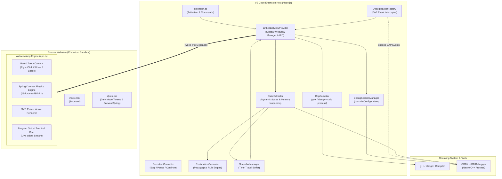
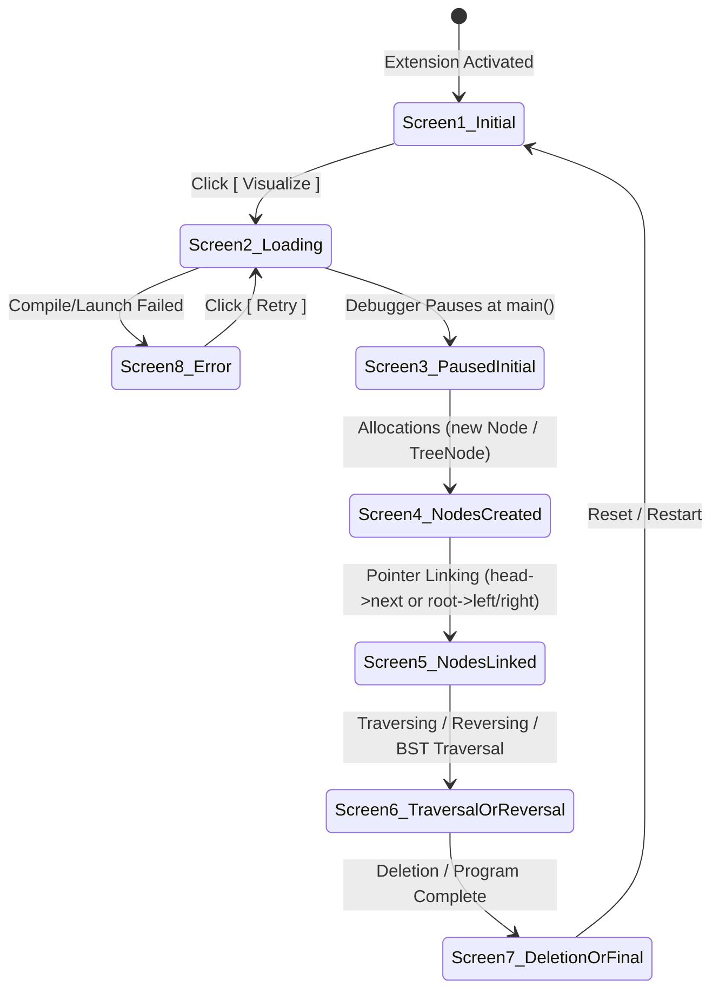

# System Architecture

This document provides a friendly, comprehensive architectural breakdown of **SimIDE** (*Simulation + IDE*). It explains how the pieces fit together in plain, accessible language without sacrificing technical precision.

---

## High-Level Architecture Overview

SimIDE operates across three distinct process boundaries:



---

## The 4 Core Subsystems

The extension is organized into 4 cleanly decoupled subsystems:

### 1. The Debugger Subsystem (`src/debug/`)
* **Role**: Orchestrates the native C++ toolchain and communicates with GDB/LLDB using VS Code's Debug Adapter Protocol (DAP).
* **Key Components**:
  - `compiler.ts`: Locates installed compilers (`g++`, `clang++`), creates an isolated build directory (`.debug-mentor/`), and builds C++ files with essential debugging flags (`-g -O0 -std=c++17`). Handles file-lock collisions on Windows via timestamped fallback binaries. Tracks the actively focused editor tab (`setLastActiveSourceFile`, `resolveSourceFile`) across tab switches and multi-file workspaces.
  - `debugSessionManager.ts`: Dynamically discovers GDB/LLDB in system paths, constructs the `cppdbg` launch configuration, configures entry breakpoints (`stopAtEntry: true`), and starts the session with `internalConsoleOptions: 'neverOpen'` and `suppressDebugView: true` to prevent intrusive debug panels from opening.
  - `debugAdapterTracker.ts`: Intercepts low-level DAP events (`stopped`, `continued`, `terminated`) sent by the debugger adapter without interfering with VS Code's native debug tools.
  - `executionController.ts`: Dispatches execution commands (step over, step in, step out, continue, pause) via DAP custom requests or VS Code commands.
  - `stateExtractor.ts`: The central inspection engine.
    - Dynamically scans the user's C++ source file to discover struct definitions (`Node`, `ListNode`, `TreeNode`, `CircularQueue`, `Stack`), pointer declarations, and user-defined functions (`printList`, `reverseList`, `push`, `pop`, `enqueue`, `dequeue`, `deleteNode`, `insert`, `inorder`, class methods).
    - Detects data structure mode (`linked_list`, `tree`, `array`, `stack`, `queue`) based on struct member definitions and array declarations.
    - In tree mode, runs BFS `traverseTree` from root address, calculates depth levels (`treeDepth`), and assigns non-overlapping horizontal columns (`treeColumn`) via in-order traversal indexing.
    - Resolves root pointers across recursive helper stack frames by looking up caller frames if the current frame receives a by-value `nullptr` parameter.
    - In stack mode (`extractStackState`), evaluates `top`, `capacity`, and array items (`arr`, `items`, `data`) across caller frames, tracking active push, pop, and peek operations.
    - In circular queue mode (`extractQueueState`), evaluates `front`, `rear`, `count`, `capacity`, and buffer slots across all stack frames (`this->front`, `q.front`, caller frames). Prevents premature pointer resets (`front = -1`, `rear = -1`) when size is 0 and tracks circular wrap-around (`(rear + 1) % capacity`).
    - Prevents uninitialized stack memory from appearing as ghost nodes on Step 1 by enforcing `rawLine > declLine` and `hasSteppedPastFirstPointerDecl`.
    - Tracks memory freeing via `delete` and records `deletedAddresses` (including Case A leaf and single-child BST deletions).
    - Captures `std::cout` / `printf` calls and accumulates terminal output.
    - Filters out C Runtime (CRT) startup/exit frames to keep the final visual state intact.

### 2. The Visualization Engine (`src/visualization/`)
* **Role**: Transforms raw runtime data into pedagogical models and manages non-destructive historical navigation.
* **Key Components**:
  - `linkedListModel.ts`: Defines standard TypeScript interfaces (`ListNode`, `PointerVariable`, `LinkedListSnapshot`, `SourceLocation`, `ChangeType`, `StructureType`, `ArrayVariable`, `IndexPointer`, `StackModel`, `QueueModel`, `QueueSlot`). Includes coordinates for trees, arrays, stacks, and circular queues.
  - `explanationGenerator.ts`: A rule-based pedagogical explainer. It compares the previous snapshot with the current snapshot to generate clear teaching explanations for:
    - Node creation and detached allocations
    - Head/Root assignment and pointer aliasing
    - Pointer linking and unlinking
    - Binary Search Tree branch links (`left`, `right`) and traversal visits (`inorder`, `preorder`, `postorder`)
    - Node bypassing and memory deletions via `delete` (including BST Case A deletions)
    - Array element updates, swaps, and index pointer movements (`i`, `j`, `k`, `low`, `high`, `mid`)
    - Stack push (`stack_push`), pop (`stack_pop`), peek (`stack_peek`), and overflow/underflow warnings
    - Circular queue enqueue (`queue_enqueue`), dequeue (`queue_dequeue`), circular wrap-around (`queue_wrap`), and full/empty states
    - Pointer movements during traversals (e.g. `curr = curr->next` or tree recursions)
    - Live terminal output statements
  - `snapshotManager.ts`: Stores an immutable history of every execution step. Allows scrubbing backward and forward through previous states without restarting the process.

### 3. The Sidebar Webview Provider (`src/sidebar/`)
* **Role**: Acts as the central hub bridging VS Code, the debugger, and the user interface.
* **Key Components**:
  - `linkedListViewProvider.ts`: Implements `vscode.WebviewViewProvider`. Manages the sidebar lifecycle, registers listeners for debugger events, highlights source code lines in the active editor during historical playback, guards against stepping past the final state, and handles bidirectional message passing.
  - **Non-Intrusive Tab Switching**: Monitors `onDidChangeActiveTextEditor` without forcing editor focus or redirecting the user back via `showTextDocument` when they intentionally switch tabs.
  - **Panel Suppression**: Automatically closes bottom terminal/output panels (`workbench.action.closePanel`) upon clicking Visualize to provide an unobstructed canvas view.
  - `messages.ts`: Strongly typed message protocols (`ExtensionMessage` and `WebviewMessage`) preventing runtime IPC protocol mismatches.

### 4. The Webview Presentation Layer (`webview/`)
* **Role**: Runs inside an isolated Chromium iframe in VS Code to render the interactive UI.
* **Key Components**:
  - `index.html`: Clean, semantic HTML layout with containers for controls, linked list/tree canvas, terminal output card, pedagogical explanation, and diagnostic banners.
  - `styles.css`: Strict dark-mode styling utilizing `#0D1117` palette, rounded pill buttons, infinite dot-grid background, zero scrollbars, terminal card styling, circular tree nodes (`.tree-node-card`), green pulse visiting animations (`.visiting`), array cells with spring lift (`.cell-thrust`), vertical stack tray (`.stack-board`), and circular queue strip with persistent `FRONT` and `REAR` badges (`.ptr-front`, `.ptr-rear`).
  - `app.ts`: Client-side rendering and physics simulation engine:
    - **Multi-Structure Dynamic Layout**:
      - **Linked List**: D3 force-directed physics simulation (`d3.forceManyBody()`, `d3.forceLink()`, `d3.forceCenter()`) with interactive drag & drop.
      - **Binary Search Tree**: Fixed-coordinate in-order column and depth layout (`node.treeColumn * 64px`, `node.treeDepth * 70px`), with downward cubic bezier branch arrows clipped to circular node perimeters via `getCirclePerimeterIntersection`.
      - **Linear Array**: Horizontal array board with floating index pointer pills, elevated active slots, and spring draggable cells.
      - **Stack (LIFO)**: Vertical stack tray with bottom-up indexing, elevated top element, and animated `TOP` pointer badge.
      - **Circular Queue (FIFO)**: Horizontal circular buffer with persistent `FRONT` and `REAR` badges displaying across method calls and caller frames, showing wrap-around movements and current capacity slots.
    - **Pan & Zoom Camera**: Excalidraw-style canvas navigation with Right-Click Pan, Mouse Wheel Zoom (0.35x to 2.5x), Spacebar drag, and double-click to reset.
    - **Live Terminal Card**: Displays real-time output printed by the running C++ program.

---

## Dynamic Function & Paradigm Support

SimIDE handles complex real-world C++ patterns:

### 1. Multi-Function Call Stack Tracing
When code calls helper functions like:
```cpp
void printList(Node* head) { ... }
ListNode* reverseList(ListNode* head) { ... }
void deleteNode(Node** head_ref, int key) { ... }
```
`StateExtractor`:
1. Identifies when the active stack frame enters a user-defined function.
2. Extracts function arguments (e.g., `head_ref`, `key`, `head`).
3. Tracks pointer advancements (`curr = curr->next`) as execution steps line-by-line within the function.
4. Explains the traversal: *"Pointer 'curr' advanced to node containing 20."*

### 2. Heap Deletion & Memory Freeing (`delete temp`)
When a node is deleted from memory:
1. `StateExtractor` detects that `delete` has executed on an address.
2. The address is added to `deletedAddresses`.
3. The visualizer detaches the node and displays: *"Freed heap memory for node containing 20 ('temp') via delete."*
4. If a preceding node's `next` pointer was redirected to bypass the deleted node, the explainer announces: *"Node containing 10 unlinked from node 20 and now points directly to node 30 (bypassing node 20)."*

### 3. Live Program Output Terminal Stream
When the program executes `std::cout << current->data << " -> ";`:
1. `StateExtractor.evaluatePrintStatement()` extracts the evaluated text.
2. Accumulates output into `accumulatedTerminalOutput`.
3. Sends output to the Webview terminal card, streaming the console output live alongside the visual diagram!

### 4. Binary Search Trees (BST) & Traversal Tracing
SimIDE dynamically switches from linked list to tree mode when it detects `left` and `right` struct members:
1. **Dynamic Type & Member Resolution**: Inspects the struct type (`Node`, `TreeNode`) directly from user code, avoiding GDB variable cast errors.
2. **In-Order Horizontal Positioning**: Runs an in-order traversal to compute deterministic horizontal columns (`treeColumn = colIndex++`), guaranteeing that left children always render to the left of their parents and right children render to the right.
3. **Depth Levels**: Measures hierarchical level from root (`treeDepth`), placing the root at level 0 and subsequent generations at descending levels.
4. **Visiting Indicator Pulse**: Highlights the node actively being visited during recursive or iterative traversals (`inorder`, `preorder`, `postorder`) with a pulsing green indicator (`.visiting`).
5. **Caller Frame Root Discovery**: In recursive functions like `insert(root, val)` or `inorder(root)`, if a base-case stack frame receives `root == nullptr`, `StateExtractor` walks up the call stack to find the original root pointer in `main()` so the full tree topology is never lost during recursive steps.
6. **Case A Deletion Support**: Accurately tracks leaf and single-child node deletions, unlinking parent branch pointers and updating heap allocation tracking.

### 5. Linear Array Simulation & Index Pointer Tracking
When analyzing linear array algorithms (traversals, searching, sorting, swaps):
1. **Declaration Parsing**: Scans for static stack arrays (`int arr[5]`) and dynamic heap arrays (`int* arr = new int[5]`).
2. **Interactive Cell Board**: Each array cell supports spring-damper drag physics and lifts upward (`.cell-thrust`) when active.
3. **Dynamic Index Pointers**: Tracks variable indices (`i`, `j`, `k`, `low`, `high`, `mid`, `start`, `end`) across function calls and renders color-coded badge pills floating directly above their target slot index.
4. **Mutations & Swaps**: Highlights mutated indices (`arr[2] = 99`) and swaps (`temp = arr[0]; arr[0] = arr[1]; arr[1] = temp;`) with distinct pedagogical descriptions.

### 6. Stack (LIFO) Push/Pop/Peek Simulation
When analyzing stack structures (`Stack s;`):
1. **Multi-Frame Top Evaluation**: Evaluates `top` / `topIndex` across member methods (`push`, `pop`, `peek`) and caller frames.
2. **Vertical Tray Layout**: Displays elements stacked bottom-up with the `TOP` badge floating above the uppermost element.
3. **Boundary Protections**: Automatically detects and alerts on Stack Overflow (`top >= capacity`) and Stack Underflow (`top == -1` on pop).

### 7. Circular Queue (FIFO) Simulation & Continuous Pointer Tracking
Circular buffers represent one of the most conceptually challenging concepts for beginners due to index wrap-around:
1. **Multi-Frame Pointer Persistence**: Evaluates `front`, `rear`, `count`, and `capacity` across all stack frames (`this->front`, `q.front`, caller frames). Pointers continue tracking seamlessly when stepped into helper functions or member methods (`enqueue`, `dequeue`, `isFull`, `isEmpty`, `getFront`).
2. **Wrap-Around Recognition**: Accurately identifies and explains pointer wrapping events:
   `↺ Circular Queue Wrap-Around! Rear wrapped around: rear = (4 + 1) % 5 = 0. Enqueued value at front index 0!`
3. **Non-Destructive Pointer Display**: Preserves `FRONT` and `REAR` badges even when `size == 0` or during in-method setup lines, preventing UI badges from disappearing during transitions.

### 8. Multi-File Switching & Non-Intrusive Active Editor Tracking
In multi-file educational workspaces (e.g., alternating between `linked-list.cpp`, `bst-traversals.cpp`, `array-operations.cpp`, and `circular-queue.cpp`):
1. **Active Editor Registration**: `CppCompiler.setLastActiveSourceFile` and `LinkedListViewProvider` track the focused C++ file across visible editors and tab focus changes.
2. **Zero-Redirect Tab Switching**: When users open or click another tab, `LinkedListViewProvider` updates its internal active file pointer without invoking `vscode.window.showTextDocument` to force-redirect the user back to the old file.
3. **Isolated Binary Compilation**: Each source file compiles to its own isolated target in `.debug-mentor/`, preserving independent build states and executables.

### 9. Zero-Distraction Debugging & Panel Suppression
To maximize visual screen real estate on smaller laptop screens:
1. **Debug Console Suppression**: `DebugSessionManager` configures `internalConsoleOptions: 'neverOpen'` so VS Code's native Debug Console does not steal focus or pop open on every breakpoint.
2. **AI Sidebar Suppression**: Suppresses third-party and background AI agent sidebars when starting a debugging session.
3. **Terminal Auto-Dismissal**: When the user clicks `[ Visualize ]`, `LinkedListViewProvider` dispatches `workbench.action.closePanel`, dismissing bottom task output panels and leaving the editor and SimIDE simulation canvas front and center.

---

## Memory Address Virtualization & Stable IDs

In C++, dynamic memory addresses look like hexadecimal strings: `0x74a3b0`, `0x74a3f0`, `0x750bf0`.

If the UI tried to track nodes directly by raw hexadecimal addresses:
- Memory addresses change every single time the program runs.
- Addresses vary across operating systems (64-bit Windows vs Linux vs macOS).
- Diagrams could flicker or lose drag positions if IDs change.

**Solution: Stable Node ID Translation**
The `StateExtractor` maintains an internal map:
```
Memory Address   ===>  Stable ID
0x74a3b0         ===>  node_1
0x74a3f0         ===>  node_2
0x750bf0         ===>  node_3
```
- When a pointer points to `0x74a3f0`, the snapshot records `nextId: "node_2"` (or `leftId` / `rightId` for trees).
- The Webview uses `node_1`, `node_2` as DOM and SVG element IDs. When a node moves or updates, its physics body and drag positions remain completely stable.

---

## The 8+ UI States

The sidebar transitions through clearly defined pedagogical states:



| State | UI Display | Pedagogical Explanation |
| :--- | :--- | :--- |
| **1. Initial IDE State** | Hero icon, subtitle, `[ ▶ Visualize ]` pill button | Ready to begin session. |
| **2. Loading State** | Animated spinner, progress text | *"Preparing C++ program..."* → *"Compiling source..."* → *"Starting debugger..."* |
| **3. Initial Paused State** | Empty canvas message or `head / root ──▶ nullptr`, step 1 indicator | *"Program paused at start of main(). Click Next to allocate and initialize."* |
| **4. Nodes Allocated** | Detached cards in staging row | *"`first` pointer created, pointing to a new Node containing 10."* or *"Allocated new tree node containing 50."* |
| **5. Nodes Connected** | SVG arrows connect node cards | *"Node 10 now points to node 20."* or *"Node 30 attached as left child of 50."* |
| **6. Traversal / Loop** | Pointer badges move across nodes, visiting pulse in BST, live output in Terminal | *"Pointer 'current' advanced to node 20."* or *"Visiting node 30 during inorder traversal. Printed: '30 '"* |
| **7. Reversal / Deletion** | Pointers flip or bypassed node is deleted via `delete` | *"Freed heap memory for node containing 20 via delete."* or *"Case A deletion: removed leaf node 20."* |
| **8. Final State** | Complete structure remains on canvas, Next disabled | *"The linked list / tree is complete. Program execution finished."* |
| **9. Error State** | Danger icon, error message, diagnostic stack, `[ Retry ]` button | Displays actionable troubleshooting details if compilation or debugger fails. |

---

## Non-Destructive Time-Travel

When debugging, learners frequently want to step backward to see how a pointer was assigned. However, standard GDB does not support reverse execution without specialized record/replay target architectures.

SimIDE solves this with **non-destructive historical snapshots**:
1. Every time the debugger pauses, a complete snapshot is appended to `SnapshotManager`.
2. When the user clicks **Previous**:
   - The running GDB process remains untouched and paused at its real location.
   - The Webview updates to display the previous snapshot.
   - A historical banner displays: *"Viewing historical snapshot (Step X of Y)"*.
   - `LinkedListViewProvider` uses VS Code text editor decorations to highlight the historical code line with a dashed blue border.
3. When the user clicks **Next**:
   - If historical snapshots are ahead, it advances forward through history.
   - Once the user reaches the latest live step, clicking **Next** issues a real DAP step command to GDB.
