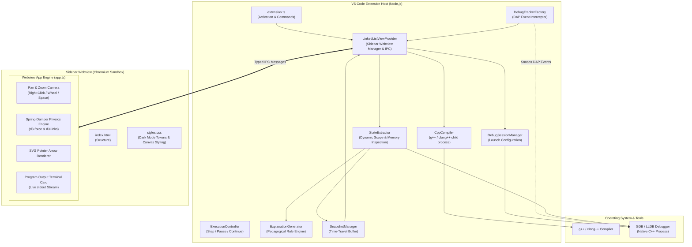
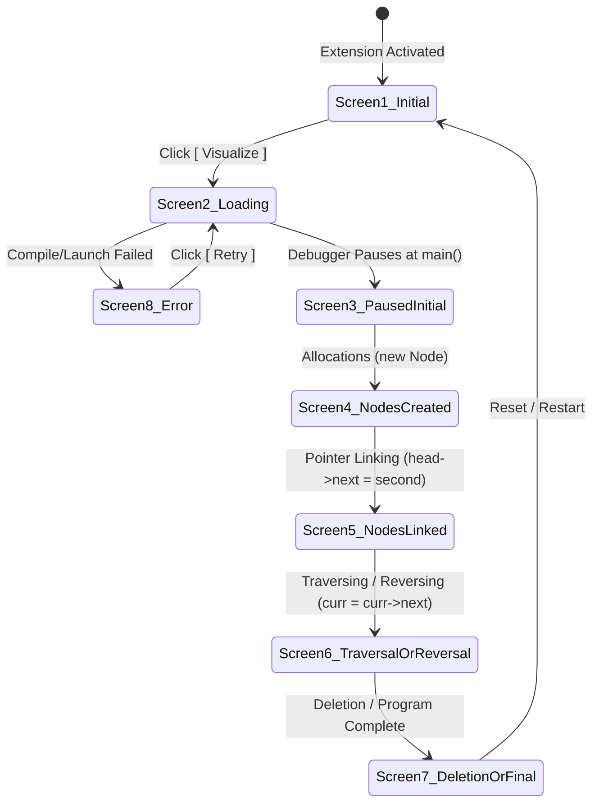

# System Architecture

This document provides a friendly, comprehensive architectural breakdown of **SimIDE** (*Simulation + IDE*). It explains how the pieces fit together in plain, accessible language without sacrificing technical precision.

---

## High-Level Architecture Overview

SimIDE operates across three distinct process boundaries:



---

## The 4 Core Subsystems

The extension is organized into 4 cleanly decoupled subsystems:

### 1. The Debugger Subsystem (`src/debug/`)
* **Role**: Orchestrates the native C++ toolchain and communicates with GDB/LLDB using VS Code's Debug Adapter Protocol (DAP).
* **Key Components**:
  - `compiler.ts`: Locates installed compilers (`g++`, `clang++`), creates an isolated build directory (`.debug-mentor/`), and builds C++ files with essential debugging flags (`-g -O0 -std=c++17`). Handles file-lock collisions on Windows via timestamped fallback binaries.
  - `debugSessionManager.ts`: Dynamically discovers GDB/LLDB in system paths, constructs the `cppdbg` launch configuration, configures entry breakpoints (`stopAtEntry: true`), and starts the session.
  - `debugAdapterTracker.ts`: Intercepts low-level DAP events (`stopped`, `continued`, `terminated`) sent by the debugger adapter without interfering with VS Code's native debug tools.
  - `executionController.ts`: Dispatches execution commands (step over, step in, step out, continue, pause) via DAP custom requests or VS Code commands.
  - `stateExtractor.ts`: The central inspection engine.
    - Dynamically scans the user's C++ source file to discover struct definitions (`Node`, `ListNode`), pointer declarations, and user-defined functions (`printList`, `reverseList`, `push`, `deleteNode`, class methods).
    - Traverses memory chains from `head` as well as disconnected/detached chains.
    - Tracks memory freeing via `delete` and records `deletedAddresses`.
    - Captures `std::cout` / `printf` calls and accumulates terminal output.
    - Filters out C Runtime (CRT) startup/exit frames to keep the final visual state intact.

### 2. The Visualization Engine (`src/visualization/`)
* **Role**: Transforms raw runtime data into pedagogical models and manages non-destructive historical navigation.
* **Key Components**:
  - `linkedListModel.ts`: Defines standard TypeScript interfaces (`ListNode`, `PointerVariable`, `LinkedListSnapshot`, `SourceLocation`, `ChangeType`).
  - `explanationGenerator.ts`: A rule-based pedagogical explainer. It compares the previous snapshot with the current snapshot to generate clear teaching explanations for:
    - Node creation and detached allocations
    - Head assignment and pointer aliasing
    - Pointer linking and unlinking
    - Node bypassing and memory deletions via `delete`
    - Pointer movements during traversals (e.g. `curr = curr->next`)
    - Live terminal output statements
  - `snapshotManager.ts`: Stores an immutable history of every execution step. Allows scrubbing backward and forward through previous states without restarting the process.

### 3. The Sidebar Webview Provider (`src/sidebar/`)
* **Role**: Acts as the central hub bridging VS Code, the debugger, and the user interface.
* **Key Components**:
  - `linkedListViewProvider.ts`: Implements `vscode.WebviewViewProvider`. Manages the sidebar lifecycle, registers listeners for debugger events, highlights source code lines in the active editor during historical playback, guards against stepping past the final state, and handles bidirectional message passing.
  - `messages.ts`: Strongly typed message protocols (`ExtensionMessage` and `WebviewMessage`) preventing runtime IPC protocol mismatches.

### 4. The Webview Presentation Layer (`webview/`)
* **Role**: Runs inside an isolated Chromium iframe in VS Code to render the interactive UI.
* **Key Components**:
  - `index.html`: Clean, semantic HTML layout with containers for controls, linked list canvas, terminal output card, pedagogical explanation, and diagnostic banners.
  - `styles.css`: Strict dark-mode styling utilizing `#0D1117` palette, rounded pill buttons, infinite dot-grid background, zero scrollbars, and terminal card styling.
  - `app.ts`: Client-side rendering and physics simulation engine:
    - **D3 Force Simulation**: Models pointer connections as elastic distance springs and nodes as repulsive charged particles (`d3.forceManyBody()`, `d3.forceLink()`, `d3.forceCenter()`).
    - **Interactive Drag & Drop**: Users can click and drag any node card; connecting springs react live.
    - **Pan & Zoom Camera**: Excalidraw-style canvas navigation with Right-Click Pan, Mouse Wheel Zoom (0.35x to 2.5x), Spacebar drag, and double-click to reset.
    - **Live Terminal Card**: Displays real-time output printed by the running C++ program.

---

## Dynamic Function & Paradigm Support

SimIDE handles complex real-world C++ patterns:

### 1. Multi-Function Call Stack Tracing
When code calls helper functions like:
```cpp
void printList(Node* head) { ... }
ListNode* reverseList(ListNode* head) { ... }
void deleteNode(Node** head_ref, int key) { ... }
```
`StateExtractor`:
1. Identifies when the active stack frame enters a user-defined function.
2. Extracts function arguments (e.g., `head_ref`, `key`, `head`).
3. Tracks pointer advancements (`curr = curr->next`) as execution steps line-by-line within the function.
4. Explains the traversal: *"Pointer 'curr' advanced to node containing 20."*

### 2. Heap Deletion & Memory Freeing (`delete temp`)
When a node is deleted from memory:
1. `StateExtractor` detects that `delete` has executed on an address.
2. The address is added to `deletedAddresses`.
3. The visualizer detaches the node and displays: *"Freed heap memory for node containing 20 ('temp') via delete."*
4. If a preceding node's `next` pointer was redirected to bypass the deleted node, the explainer announces: *"Node containing 10 unlinked from node 20 and now points directly to node 30 (bypassing node 20)."*

### 3. Live Program Output Terminal Stream
When the program executes `std::cout << current->data << " -> ";`:
1. `StateExtractor.evaluatePrintStatement()` extracts the evaluated text.
2. Accumulates output into `accumulatedTerminalOutput`.
3. Sends output to the Webview terminal card, streaming the console output live alongside the visual diagram!

---

## Memory Address Virtualization & Stable IDs

In C++, dynamic memory addresses look like hexadecimal strings: `0x74a3b0`, `0x74a3f0`, `0x750bf0`.

If the UI tried to track nodes directly by raw hexadecimal addresses:
- Memory addresses change every single time the program runs.
- Addresses vary across operating systems (64-bit Windows vs Linux vs macOS).
- Diagrams could flicker or lose drag positions if IDs change.

**Solution: Stable Node ID Translation**
The `StateExtractor` maintains an internal map:
```
Memory Address   ===>  Stable ID
0x74a3b0         ===>  node_1
0x74a3f0         ===>  node_2
0x750bf0         ===>  node_3
```
- When a pointer points to `0x74a3f0`, the snapshot records `nextId: "node_2"`.
- The Webview uses `node_1`, `node_2` as DOM and SVG element IDs. When a node moves or updates, its physics body and drag positions remain completely stable.

---

## The 8+ UI States

The sidebar transitions through clearly defined pedagogical states:



| State | UI Display | Pedagogical Explanation |
| :--- | :--- | :--- |
| **1. Initial IDE State** | Hero icon, subtitle, `[ ▶ Visualize ]` pill button | Ready to begin session. |
| **2. Loading State** | Animated spinner, progress text | *"Preparing C++ program..."* → *"Compiling source..."* → *"Starting debugger..."* |
| **3. Initial Paused State** | Empty canvas message or `head ──▶ nullptr`, step 1 indicator | *"Program paused at start of main(). Click Next to allocate and initialize the linked list."* |
| **4. Nodes Allocated** | Detached cards visible in the canvas with spring links | *"`first` pointer created, pointing to a new Node containing 10."* |
| **5. Nodes Connected** | SVG arrows connect node cards with spring recoil | *"The node containing 10 now points to the node containing 20."* |
| **6. Traversal / Loop** | Pointer badges move across nodes, live output in Terminal | *"Pointer 'current' advanced to node containing 20. Printed to terminal: '20 -> '"* |
| **7. Reversal / Deletion** | Pointers flip or bypassed node is deleted via `delete` | *"Freed heap memory for node containing 20 via delete."* or *"Node unlinked and reversed."* |
| **8. Final State** | Complete linked list remains on canvas, Next disabled | *"The linked list is complete: head → 10 → 20 → 30 → nullptr. Program execution finished."* |
| **9. Error State** | Danger icon, error message, diagnostic stack, `[ Retry ]` button | Displays actionable troubleshooting details if compilation or debugger fails. |

---

## Non-Destructive Time-Travel

When debugging, learners frequently want to step backward to see how a pointer was assigned. However, standard GDB does not support reverse execution without specialized record/replay target architectures.

SimIDE solves this with **non-destructive historical snapshots**:
1. Every time the debugger pauses, a complete snapshot is appended to `SnapshotManager`.
2. When the user clicks **Previous**:
   - The running GDB process remains untouched and paused at its real location.
   - The Webview updates to display the previous snapshot.
   - A historical banner displays: *"Viewing historical snapshot (Step X of Y)"*.
   - `LinkedListViewProvider` uses VS Code text editor decorations to highlight the historical code line with a dashed blue border.
3. When the user clicks **Next**:
   - If historical snapshots are ahead, it advances forward through history.
   - Once the user reaches the latest live step, clicking **Next** issues a real DAP step command to GDB.
