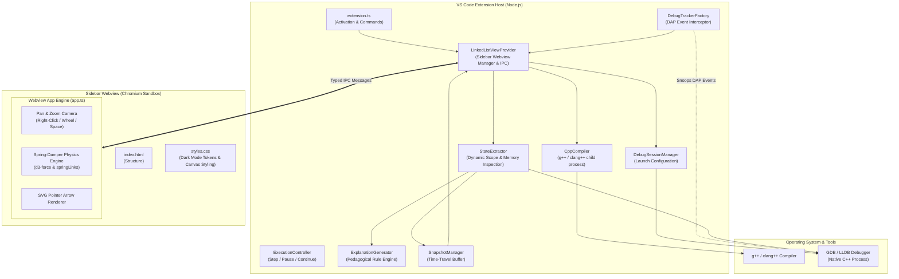
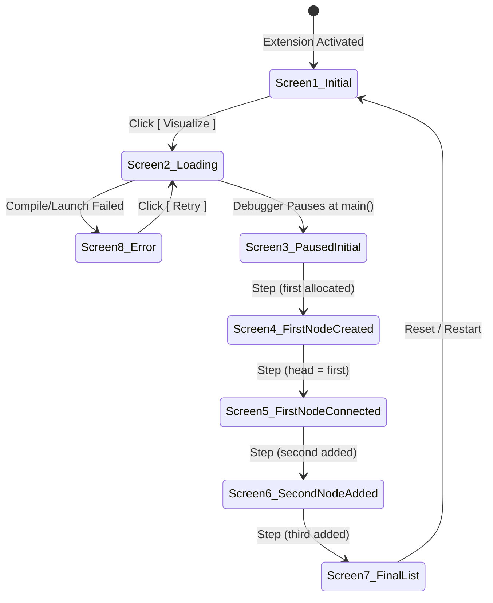

# System Architecture

This document provides a friendly, comprehensive architectural breakdown of **VS Code Debug Mentor**. It explains how the pieces fit together in plain, accessible language without sacrificing technical precision.

---

## High-Level Architecture Overview

VS Code Debug Mentor operates across three distinct process boundaries:



---

## The 4 Core Subsystems

The extension is organized into 4 cleanly decoupled subsystems:

### 1. The Debugger Subsystem (`src/debug/`)
* **Role**: Orchestrates the native C++ toolchain and communicates with GDB/LLDB using VS Code's Debug Adapter Protocol (DAP).
* **Key Components**:
  - `compiler.ts`: Locates installed compilers (`g++`, `clang++`), creates an isolated build directory (`.debug-mentor/`), and builds C++ files with essential debugging flags (`-g -O0 -std=c++17`). Handles file-lock collisions on Windows via timestamped fallback binaries.
  - `debugSessionManager.ts`: Dynamically discovers GDB/LLDB in system paths, constructs the `cppdbg` launch configuration, configures entry breakpoints (`stopAtEntry: true`), and starts the session.
  - `debugAdapterTracker.ts`: Intercepts low-level DAP events (`stopped`, `continued`, `terminated`) sent by the debugger adapter without interfering with VS Code's native debug tools.
  - `executionController.ts`: Dispatches execution commands (step over, step in, step out, continue, pause) via DAP custom requests or VS Code commands.
  - `stateExtractor.ts`: The central inspection engine. Dynamically scans the user's C++ source file to discover all pointer declarations, tracks line thresholds, evaluates variables in scope, unrolls pointers, translates memory addresses to stable IDs, and filters out C Runtime (CRT) startup/exit frames.

### 2. The Visualization Engine (`src/visualization/`)
* **Role**: Transforms raw runtime data into pedagogical models and manages non-destructive historical navigation.
* **Key Components**:
  - `linkedListModel.ts`: Defines standard TypeScript interfaces (`ListNode`, `PointerVariable`, `LinkedListSnapshot`, `SourceLocation`, `ChangeType`).
  - `explanationGenerator.ts`: A rule-based pedagogical explainer. It compares the previous snapshot with the current snapshot and analyzes active pointers to generate teaching explanations (e.g., explaining when `first` is created, when `head` is assigned to alias `first`, and when pointer connections are formed).
  - `snapshotManager.ts`: Stores an immutable history of every execution step. Allows scrubbing backward and forward through previous states without restarting the process.

### 3. The Sidebar Webview Provider (`src/sidebar/`)
* **Role**: Acts as the central hub bridging VS Code, the debugger, and the user interface.
* **Key Components**:
  - `linkedListViewProvider.ts`: Implements `vscode.WebviewViewProvider`. Manages the sidebar lifecycle, registers listeners for debugger events, highlights source code lines in the active editor during historical playback, guards against stepping past the final state, and handles bidirectional message passing.
  - `messages.ts`: Strongly typed message protocols (`ExtensionMessage` and `WebviewMessage`) preventing runtime IPC protocol mismatches.

### 4. The Webview Presentation Layer (`webview/`)
* **Role**: Runs inside an isolated Chromium iframe in VS Code to render the interactive UI.
* **Key Components**:
  - `index.html`: Clean, semantic HTML layout with dedicated containers for controls, linked list canvas, pedagogical explanation, and diagnostic banners.
  - `styles.css`: Strict dark-mode styling utilizing `#0D1117` palette, rounded pill buttons, infinite dot-grid background, zero scrollbars, and accessibility-compliant contrast.
  - `app.ts`: Client-side rendering and physics simulation engine:
    - **Spring-Damper Physics**: Models pointers as elastic springs and nodes as repulsive charged particles using a hybrid physics engine (integrated with `d3-force`).
    - **Interactive Drag & Drop**: Users can click and drag any node card; connecting arrows stretch and adjust live with natural spring recoil.
    - **Pan & Zoom Camera**: Excalidraw-style canvas navigation with Right-Click Pan, Mouse Wheel Zoom (0.35x to 2.5x), Spacebar drag, and double-click to reset.

---

## Dynamic Pointer Discovery vs Hardcoded Names

A key architectural strength of Debug Mentor is **dynamic pointer discovery**:

Instead of hardcoding a fixed list of variable names (like `first`, `second`), `StateExtractor` dynamically parses the active C++ source file:
1. **Source Scanning**: Scans source lines using regular expressions matching pointer declarations:
   ```regex
   (?:Node\s*\*|auto\s*\*?)\s*([a-zA-Z_][a-zA-Z0-9_]*)
   ```
   This accurately detects any variable names the student chooses (`head`, `first`, `newNode`, `curr`, `temp`, `secondNode`, etc.) along with the line number on which each is declared.
2. **Declaration Line Thresholding**: In C++, a variable declared on line 12 contains garbage memory before line 12 executes. `StateExtractor` checks:
   ```typescript
   if (currentLine <= varInitLine) {
     continue; // Skip variable until its declaration line has completed execution
   }
   ```
3. **Active Pointer Collection**: When valid, each pointer is recorded into an `activePointers` array with its name, target address, target node ID, and null status.

---

## Pointer Aliasing Explained Simply

In linked list operations, multiple pointers frequently refer to the same node in memory:
```cpp
Node* first = new Node{10, nullptr};
Node* head = first;
```
Here, both `head` and `first` store the exact same memory address (e.g., `0x74a3b0`).

Debug Mentor handles this explicitly:
1. `StateExtractor` identifies that `head` and `first` point to `node_1`.
2. Both pointer badges are rendered pointing to `node_1`:
   - `head` is rendered with a prominent blue badge (`head`).
   - `first` is rendered with an active green badge (`first`).
3. `ExplanationGenerator` detects this alias and teaches the concept:
   > *"head points to the node containing 10 (aliasing pointer 'first' at address 0x74a3b0)."*

---

## Memory Address Virtualization & Stable IDs

In C++, dynamic memory addresses look like hexadecimal strings: `0x74a3b0`, `0x74a3f0`, `0x750bf0`.

If the UI tried to track nodes directly by raw hexadecimal addresses:
- Memory addresses change every single time the program runs.
- Addresses vary across operating systems (64-bit Windows vs Linux vs macOS).
- Diagrams could flicker or lose drag positions if IDs change.

**Solution: Stable Node ID Translation**
The `StateExtractor` maintains an internal map:
```
Memory Address   ===>  Stable ID
0x74a3b0         ===>  node_1
0x74a3f0         ===>  node_2
0x750bf0         ===>  node_3
```
- When a pointer points to `0x74a3f0`, the snapshot records `nextId: "node_2"`.
- The Webview uses `node_1`, `node_2` as DOM and SVG element IDs. When a node moves or updates, its physics body and drag positions remain completely stable.

---

## C Runtime (CRT) Boundary Protection

When stepping through a C++ program in GDB, advancing past `return 0;` or the closing brace of `main()` enters the C Runtime startup/teardown routines (e.g. `__tmainCRTStartup` or `exit`).

Without boundary protection, entering CRT frames causes:
- The active source file to switch to internal GCC library paths.
- Local variables (`head`, `first`) to be popped off the stack, flashing an empty or corrupted diagram.

**Debug Mentor's Solution**:
`StateExtractor` inspects the top stack frame function name and source path:
```typescript
const isMain = funcName === 'main' || funcName.startsWith('main(');
const isCrt = funcName.toLowerCase().includes('crt') || ...;

if (!isMain || isCrt) {
  // Preserve the completed linked list diagram and mark changeType: 'final'
  return {
    ...previousSnapshot,
    stepNumber,
    explanation: 'Program execution completed. The linked list is complete.',
    changeType: 'final',
  };
}
```
Furthermore, `LinkedListViewProvider` disables the **Next** button once `changeType === 'final'`, preventing students from accidentally stepping into runtime exit routines!

---

## The 8 UI States

The sidebar transitions through 8 clearly defined states:



| State | UI Display | Pedagogical Explanation |
| :--- | :--- | :--- |
| **1. Initial IDE State** | Hero icon, subtitle, `[ ▶ Visualize ]` pill button | Ready to begin session. |
| **2. Loading State** | Animated spinner, progress text | *"Preparing C++ program..."* → *"Compiling source..."* → *"Starting debugger..."* |
| **3. Initial Paused State** | Empty canvas message or `head ──▶ nullptr`, step 1 indicator | *"Program paused at start of main(). Click Next to execute: Node* head = nullptr;"* |
| **4. First Node Visualized** | Detached card `first` with value 10 | *"first pointer created, pointing to a new Node containing 10. head is still null."* |
| **5. First Node Connected** | `head ──▶ [ 10 | • ] ──▶ nullptr` | *"head points to the node containing 10 (aliasing pointer 'first'...)"* |
| **6. Second Node Added** | `head ──▶ [ 10 | • ] ──▶ [ 20 | • ] ──▶ nullptr` | *"The node containing 10 now points to the node containing 20."* |
| **7. Final Linked List** | Complete 3-node chain (`10 → 20 → 30 → null`) | *"The linked list is complete: head → 10 → 20 → 30 → nullptr. Program execution finished."* |
| **8. Error State** | Danger icon, error message, diagnostic stack, `[ Retry ]` button | Displays actionable troubleshooting details if compilation or debugger fails. |

---

## Non-Destructive Time-Travel

When debugging, learners frequently want to step backward to see how a pointer was assigned. However, standard GDB does not support reverse execution without specialized record/replay target architectures.

Debug Mentor solves this with **non-destructive historical snapshots**:
1. Every time the debugger pauses, a complete snapshot is appended to `SnapshotManager`.
2. When the user clicks **Previous**:
   - The running GDB process remains untouched and paused at its real location.
   - The Webview updates to display the previous snapshot.
   - A historical banner displays: *"Viewing historical snapshot (Step X of Y)"*.
   - `LinkedListViewProvider` uses VS Code text editor decorations to highlight the historical code line with a dashed blue border.
3. When the user clicks **Next**:
   - If historical snapshots are ahead, it advances forward through history.
   - Once the user reaches the latest live step, clicking **Next** issues a real DAP step command to GDB.
