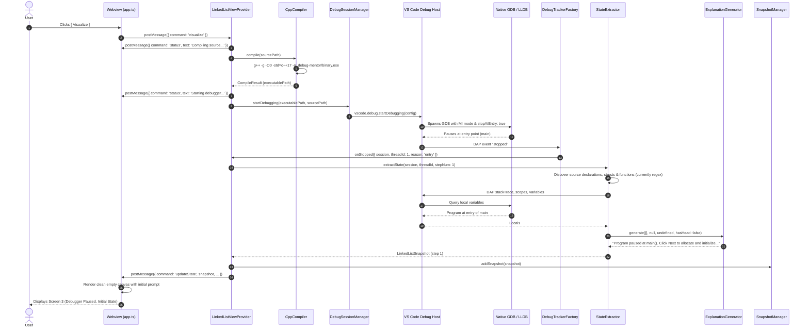
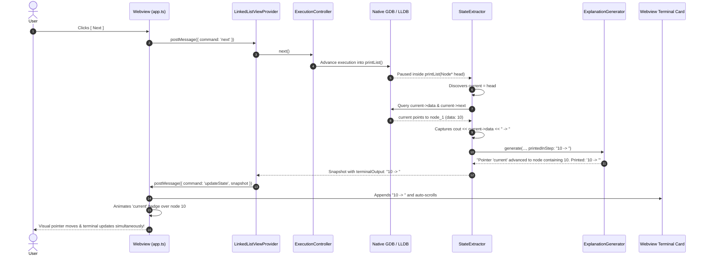
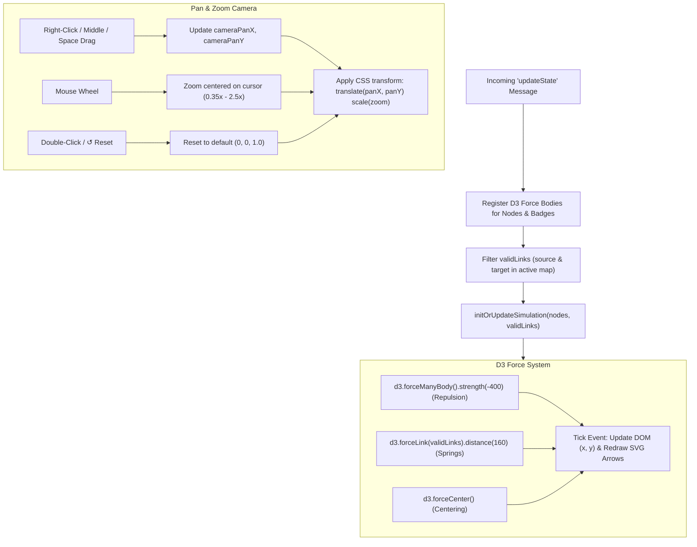
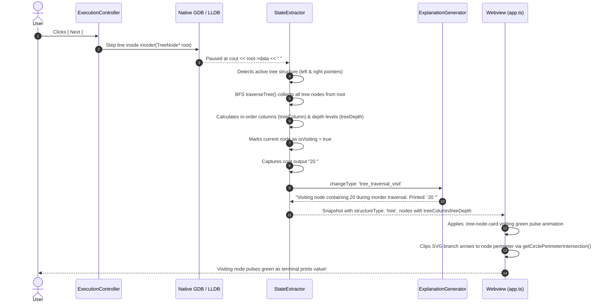
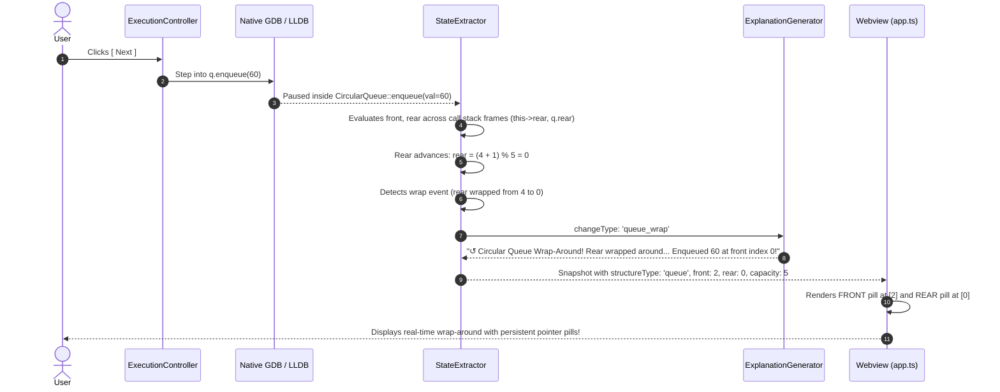
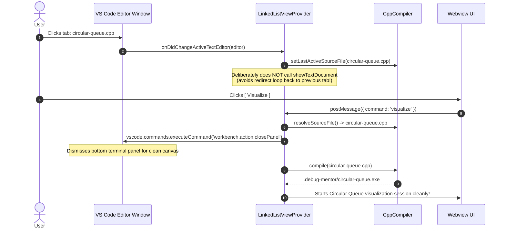

# Data Flow & Execution Lifecycles

This document traces the complete step-by-step lifecycle flows of **SimIDE**. Each flow is illustrated with a sequence diagram and accompanied by an easy-to-follow explanation.

---

## 1. Session Launch Lifecycle (Clicking [ Visualize ])

This flow begins when the user clicks the primary **[ Visualize ]** button in the sidebar or runs the `debug-mentor.visualize` command.



---

## 2. Function Stepping & Traversal Flow (e.g. `printList`)

When execution steps into helper functions and loops across linked nodes:



---

## 3. Node Deletion & Bypassing Flow (`delete temp`)

When deleting a node in functions like `deleteNode(&head, key)`:

```mermaid
sequenceDiagram
    autonumber
    actor User
    participant ExecCtrl as ExecutionController
    participant GDB as Native GDB / LLDB
    participant Extractor as StateExtractor
    participant Explainer as ExplanationGenerator
    participant Webview as Webview (app.ts)

    User->>ExecCtrl: Clicks [ Next ] (executes prev->next = temp->next)
    ExecCtrl->>GDB: Step line
    GDB-->>Extractor: Link bypassed: node 10 now points to node 30
    Extractor->>Explainer: Detects nextId changed from node_2 to node_3
    Explainer-->>Extractor: "Node containing 10 unlinked from node 20 and points to node 30 (bypassing node 20)."
    Extractor-->>Webview: Update diagram (node 20 is detached)

    User->>ExecCtrl: Clicks [ Next ] (executes delete temp)
    ExecCtrl->>GDB: Step line
    GDB-->>Extractor: Line contains "delete temp"
    Extractor->>Extractor: Records temp address in deletedAddresses
    Extractor->>Explainer: changeType: 'node_deleted'
    Explainer-->>Extractor: "Freed heap memory for node containing 20 ('temp') via delete."
    Extractor-->>Webview: Node 20 removed from physics simulation
    Webview-->>User: Node 20 disappears; surviving chain springs smoothly into alignment!
```

---

## 4. Webview D3 Physics & Camera Loop

Inside the Webview (`webview/app.ts`), an autonomous animation and interaction loop handles node positioning and camera panning:



---

## 5. Historical Navigation (Clicking [ Previous ])

When a student wants to see what the state was 2 steps ago:


---

## 6. Binary Search Tree (BST) Traversal & Visiting Node Flow

When running recursive traversals (such as `inorder(root)` or `caseA` deletions) on a Binary Search Tree:



---

## 7. Circular Queue Multi-Frame Stepping & Wrap-Around Lifecycle

When executing circular queue operations (`enqueue`, `dequeue`, `wrap-around`) across member functions:



---

## 8. Multi-File Switching Lifecycle

When switching between different C++ source files (e.g. from `linked-list.cpp` to `circular-queue.cpp`):


