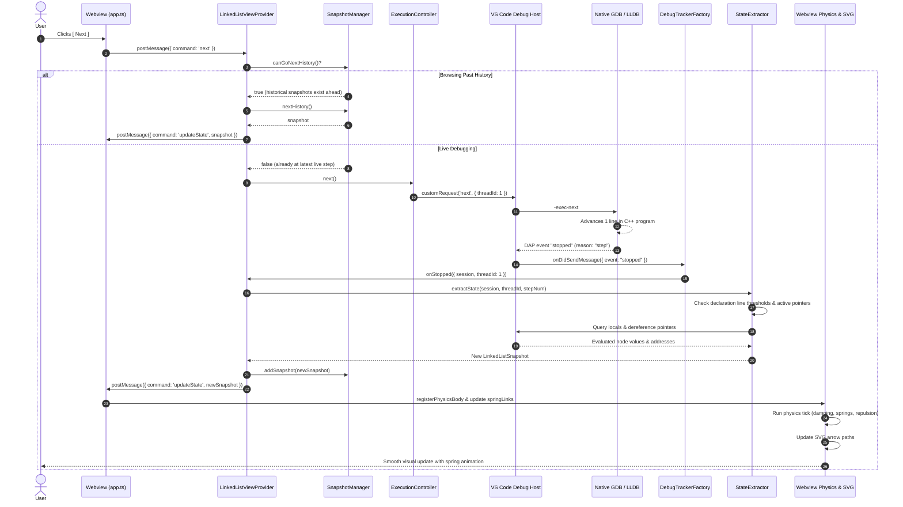
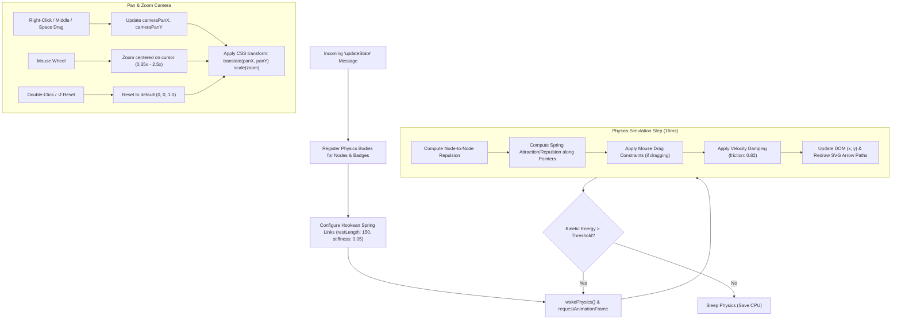
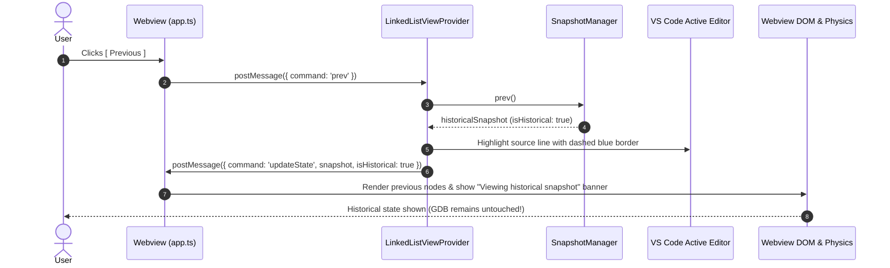
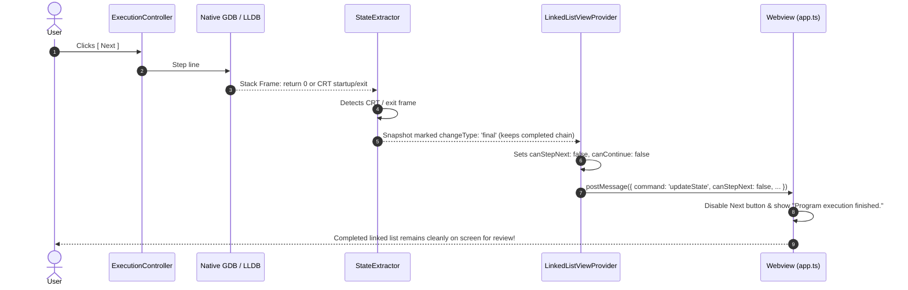

# Data Flow & Execution Lifecycles

This document traces the complete step-by-step lifecycle flows of **VS Code Debug Mentor**. Each flow is illustrated with a sequence diagram and accompanied by an easy-to-follow explanation.

---

## 1. Session Launch Lifecycle (Clicking [ Visualize ])

This flow begins when the user clicks the primary **[ Visualize ]** button in the sidebar or runs the `debug-mentor.visualize` command.

```mermaid
sequenceDiagram
    autonumber
    actor User
    participant Webview as Webview (app.ts)
    participant Provider as LinkedListViewProvider
    participant Compiler as CppCompiler
    participant SessionMgr as DebugSessionManager
    participant VSCodeDAP as VS Code Debug Host
    participant GDB as Native GDB / LLDB
    participant Tracker as DebugTrackerFactory
    participant Extractor as StateExtractor
    participant Explainer as ExplanationGenerator
    participant Snapshots as SnapshotManager

    User->>Webview: Clicks [ Visualize ]
    Webview->>Provider: postMessage({ command: 'visualize' })
    Provider->>Webview: postMessage({ command: 'status', text: 'Compiling source...' })
    Provider->>Compiler: compile(sourcePath)
    Compiler->>Compiler: g++ -g -O0 -std=c++17 -o .debug-mentor/binary.exe
    Compiler-->>Provider: CompileResult (executablePath)

    Provider->>Webview: postMessage({ command: 'status', text: 'Starting debugger...' })
    Provider->>SessionMgr: startDebugging(executablePath, sourcePath)
    SessionMgr->>VSCodeDAP: vscode.debug.startDebugging(config)
    VSCodeDAP->>GDB: Spawns GDB with MI mode & stopAtEntry: true
    GDB-->>VSCodeDAP: Pauses at entry point (main)
    VSCodeDAP->>Tracker: DAP event "stopped"
    Tracker->>Provider: onStopped({ session, threadId: 1, reason: 'entry' })

    Provider->>Extractor: extractState(session, threadId, stepNum: 1)
    Extractor->>Extractor: Scan source AST for pointer declarations & init lines
    Extractor->>VSCodeDAP: DAP stackTrace, scopes, variables
    VSCodeDAP->>GDB: Query local variables
    GDB-->>VSCodeDAP: Program at entry of main
    VSCodeDAP-->>Extractor: Locals
    Extractor->>Explainer: generate([], null, undefined, hasHead: false)
    Explainer-->>Extractor: "Program paused at main(). Click Next to execute: Node* head = nullptr;"
    Extractor-->>Provider: LinkedListSnapshot (step 1)

    Provider->>Snapshots: addSnapshot(snapshot)
    Provider->>Webview: postMessage({ command: 'updateState', snapshot, ... })
    Webview->>Webview: Render clean empty canvas with initial prompt
    Webview-->>User: Displays Screen 3 (Debugger Paused, Initial State)
```

---

## 2. Stepping Forward (Clicking [ Next ])

When the user wants to advance execution to see the next line of C++ execute:



---

## 3. Webview Physics & Camera Loop

Inside the Webview (`webview/app.ts`), an autonomous animation and interaction loop handles node positioning and camera panning:



---

## 4. Historical Navigation (Clicking [ Previous ])

When a student wants to see what the state was 2 steps ago:



---

## 5. Reaching Program Completion & CRT Boundary Guard

When execution hits `return 0;` or the closing brace:


