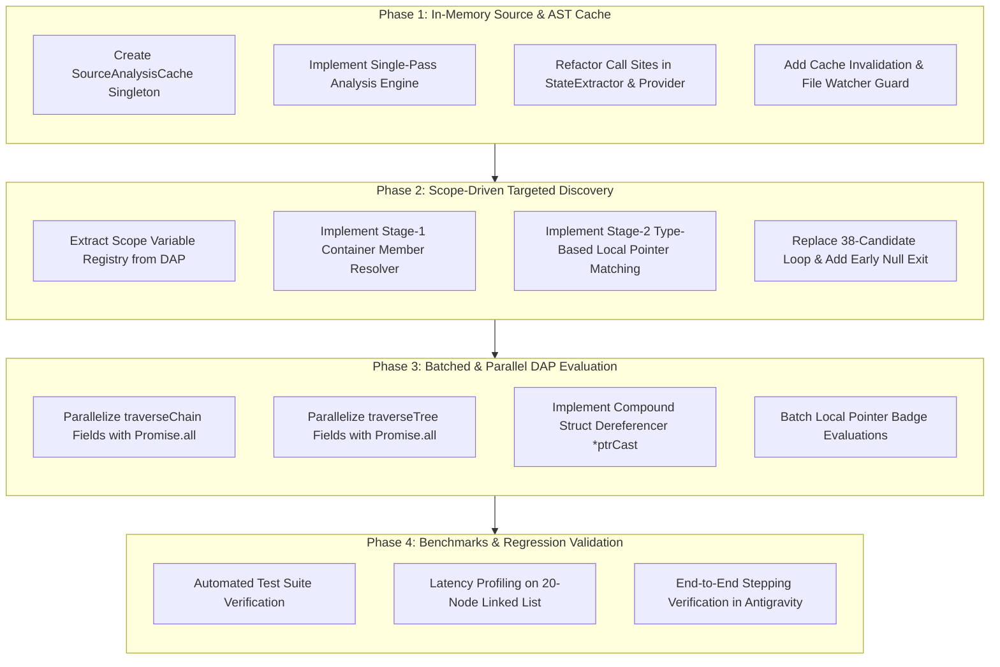

# SimIDE Performance Engineering: Phased Implementation Plan

---

## Architecture Overview

This plan details the implementation steps to eliminate the three core latency bottlenecks identified in SimIDE:
1. **Synchronous File I/O Overhead** (14x `fs.readFileSync` calls per step)
2. **Brute-Force Pointer Speculation** (38+ blind GDB queries per step)
3. **Serial N+1 DAP Roundtrip Cascade** (2-3 blocking IPC requests per node)



---

## Phase 1: In-Memory Source & AST Cache

### Objective
Eliminate all 14 synchronous disk reads per step by caching source code, tokenized lines, and AST metadata in memory for the duration of a debugging session.

### Target Files
- `src/debug/sourceAnalysisCache.ts` *(New file)*
- `src/debug/stateExtractor.ts`
- `src/sidebar/linkedListViewProvider.ts`

### Detailed Steps

#### Step 1.1: Create `SourceAnalysisCache` Singleton
Create [`src/debug/sourceAnalysisCache.ts`](file:///c:/users/khanna/projects/Simide/src/debug/sourceAnalysisCache.ts) defining:
```ts
export interface CachedSourceAnalysis {
  filePath: string;
  mtimeMs: number;
  content: string;
  lines: string[];
  visualizationMode: 'graph' | 'linked_list';
  structMembers: {
    dataField: string;
    nextField: string;
    leftField: string;
    rightField: string;
    structureType: StructureType;
  };
  nodeTypes: Set<string>;
  declaredVariables: Map<string, number[]>;
  functionRanges: Array<{
    name: string;
    startLine: number;
    endLine: number;
    params?: string[];
  }>;
  arrayDeclarations: Array<{ name: string; size: number; line: number }>;
}
```
Expose methods:
- `SourceAnalysisCache.get(filePath: string): CachedSourceAnalysis`
- `SourceAnalysisCache.invalidate(filePath?: string): void`
- `SourceAnalysisCache.clear(): void`

#### Step 1.2: Implement Single-Pass Parser
Consolidate the separate regex passes into a single pass when cache miss occurs:
- Read `fs.readFileSync(filePath, 'utf8')` **once**.
- Record `fs.statSync(filePath).mtimeMs`.
- Extract struct definitions, node types, declared pointers, function boundaries, and array declarations simultaneously.
- Store resulting `CachedSourceAnalysis` in memory.

#### Step 1.3: Refactor Call Sites in `StateExtractor`
Replace direct disk reads with `SourceAnalysisCache.get()`:
- `StateExtractor.parseStructMembers()`
- `StateExtractor.getVariableDeclarations()`
- `StateExtractor.getFunctionRanges()`
- `StateExtractor.discoverArrayDeclarations()`
- `StateExtractor.discoverNodeTypes()`

#### Step 1.4: Refactor Call Sites in `LinkedListViewProvider`
- Replace `selectVisualizationMode(fs.readFileSync(sourceFile, 'utf8'))` at lines 121 and 576 with `SourceAnalysisCache.get(sourceFile).visualizationMode`.
- Invalidate cache when starting a new session in `LinkedListViewProvider.startVisualization()`.
- Clear cache in `StateExtractor.reset()`.

#### Step 1.5: Verification Gate for Phase 1
- Run `npm run compile` to verify clean build.
- Step through a program; verify zero calls to `fs.readFileSync` during active pauses.

---

## Phase 2: Scope-Driven Targeted Discovery

### Objective
Replace the 38-candidate blind probing loop with targeted lookups against known debugger scope variables, cutting failed GDB evaluations by >90% and saving 300ms–750ms per step.

### Target Files
- `src/debug/stateExtractor.ts`

### Detailed Steps

#### Step 2.1: Build Active Variable Registry
In `StateExtractor.extractState()`:
- Utilize `localVars` (already populated from DAP `scopes` and `variables` requests).
- Build a fast lookup set `availableNames = new Set(Object.keys(localVars))`.

#### Step 2.2: Implement 3-Stage Target Candidate Pipeline
Replace the static `headCandidates` array with:

1. **Stage 1 — Container Objects**:
   - Check if any local variable has a type or name matching known container classes (`LinkedList`, `List`, `Tree`, `BST`, `Queue`, `Stack`).
   - If present (e.g. `list`), immediately target `list.head` or `list.root`.

2. **Stage 2 — Declared Local Pointers**:
   - Check `localVars` for variables whose type contains `*` or matches known Node types (`Node*`, `TreeNode*`, `ListNode*`).
   - Prioritize standard names (`head`, `root`, `first`, `start`) **only if they exist in `availableNames`**.

3. **Stage 3 — Caller Frame Fallback**:
   - If in a helper method (`this != null`), check `this->head` or `this->root` directly.
   - When inspecting `mainFrame`, inspect `main`'s `localVars` map instead of probing arbitrary symbols.

#### Step 2.3: Fast Early-Exit on Explicit Null
- If an evaluated candidate yields `nullptr`, `0x0`, `NULL`, or `(nil)`:
  - Set `headResolved = true`.
  - Set `headAddr = null`.
  - Immediately `break` from candidate inspection loop.

#### Step 2.4: Verification Gate for Phase 2
- Run `npm test` to verify container and raw pointer test suites pass.
- Log evaluation count; verify that failed GDB evaluations drop from 30+ to 0-2 per step.

---

## Phase 3: Batched & Parallel DAP Evaluation Engine

### Objective
Eliminate the serial N+1 roundtrip cascade by evaluating node fields concurrently and leveraging compound struct dereferencing, reducing node inspection time by 50%–75%.

### Target Files
- `src/debug/stateExtractor.ts`

### Detailed Steps

#### Step 3.1: Parallelize Field Evaluation in `traverseChain`
In `StateExtractor.traverseChain`:
- Replace sequential calls:
  ```ts
  // Old: Sequential
  const dataStr = await evalHeapExpr(`${ptrCast}->${dataField}`);
  const nextValStr = await evalHeapExpr(`${ptrCast}->${nextField}`);
  ```
- With concurrent execution:
  ```ts
  // New: Concurrent via Promise.all
  const [dataStr, nextValStr] = await Promise.all([
    evalHeapExpr(`${ptrCast}->${dataField}`),
    evalHeapExpr(`${ptrCast}->${nextField}`)
  ]);
  ```

#### Step 3.2: Parallelize Field Evaluation in `traverseTree`
In `StateExtractor.traverseTree`:
- Concurrently fetch `data`, `left`, and `right` for each tree node:
  ```ts
  const [dataStr, leftValStr, rightValStr] = await Promise.all([
    evalHeapExpr(`${ptrCast}->${dataField}`),
    evalHeapExpr(`${ptrCast}->${leftField}`),
    evalHeapExpr(`${ptrCast}->${rightField}`)
  ]);
  ```

#### Step 3.3: Implement Compound Struct Dereferencer (`*ptrCast`)
For standard linked list nodes, GDB can return the entire struct in a single expression:
- Implement `evalCompoundNode(ptrCast: string)`:
  - Issue `await evalHeapExpr(`*${ptrCast}`)`.
  - Parse GDB response (e.g. `{data = 10, next = 0x67c5d0}`).
  - If parsing succeeds, extract `data` and `nextAddress` in **1 roundtrip**.
  - If output format deviates or fails, fall back to Step 3.1 (`Promise.all`).

#### Step 3.4: Parallelize Local Pointer Badge Inspections
In Section 5 of `StateExtractor.extractState` (active pointers like `curr`, `temp`, `prev`):
- Filter candidate pointers first.
- Evaluate their values concurrently using `Promise.all` rather than a sequential `for` loop.

#### Step 3.5: Verification Gate for Phase 3
- Run `npm test` to verify extraction correctness.
- Profile `traverseChain` time on a 15-node list; confirm traversal finishes in <120ms.

---

## Phase 4: Benchmarks, Profiling & Regression Verification

### Objective
Validate end-to-end performance gains and guarantee full regression safety across all supported data structures.

### Verification Tasks

1. **Test Suite Execution**:
   - Run complete suite: `npm test`.
   - Verify `oopExtraction.test.ts`, `gfgExtraction.test.ts`, `arrayIndices.test.ts`, and `gdbExecution.test.ts` pass with 0 errors.

2. **Latency Profiling**:
   - Measure wall-clock time between `DebugTrackerFactory.onStopped` trigger and `broadcastState` message dispatch across:
     - `examples/oop-linked-list.cpp` (OOP Container)
     - `examples/stack-operations.cpp` (Array Stack)
     - `examples/circular-queue.cpp` (Circular Queue)
     - `examples/bst-traversals.cpp` (Binary Search Tree)
     - `examples/linked-list.cpp` (Singly Linked List)

3. **Packaging & Installation**:
   - Run `npm run compile`.
   - Package via `npx vsce package --no-dependencies`.
   - Install into Antigravity IDE and verify smooth stepping in the UI.

---

## Implementation Progress Tracker

| Task | Description | Status |
| :--- | :--- | :--- |
| `1.1` | Create `SourceAnalysisCache` class | Completed |
| `1.2` | Implement single-pass analyzer | Completed |
| `1.3` | Refactor `StateExtractor` disk reads to use cache | Completed |
| `1.4` | Refactor `LinkedListViewProvider` to use cache | Completed |
| `2.1` | Build `availableNames` registry from DAP scopes | Completed |
| `2.2` | Implement 3-stage targeted candidate pipeline | Completed |
| `2.3` | Add fast early null exit | Completed |
| `3.1` | Parallelize `traverseChain` with `Promise.all` | Completed |
| `3.2` | Parallelize `traverseTree` with `Promise.all` | Completed |
| `3.3` | Implement compound `*ptrCast` evaluation | Completed |
| `3.4` | Parallelize local pointer badge inspections | Completed |
| `4.1` | Run automated test suite | Pending |
| `4.2` | Measure latency benchmarks | Pending |
| `4.3` | Repackage and install VSIX | Pending |
