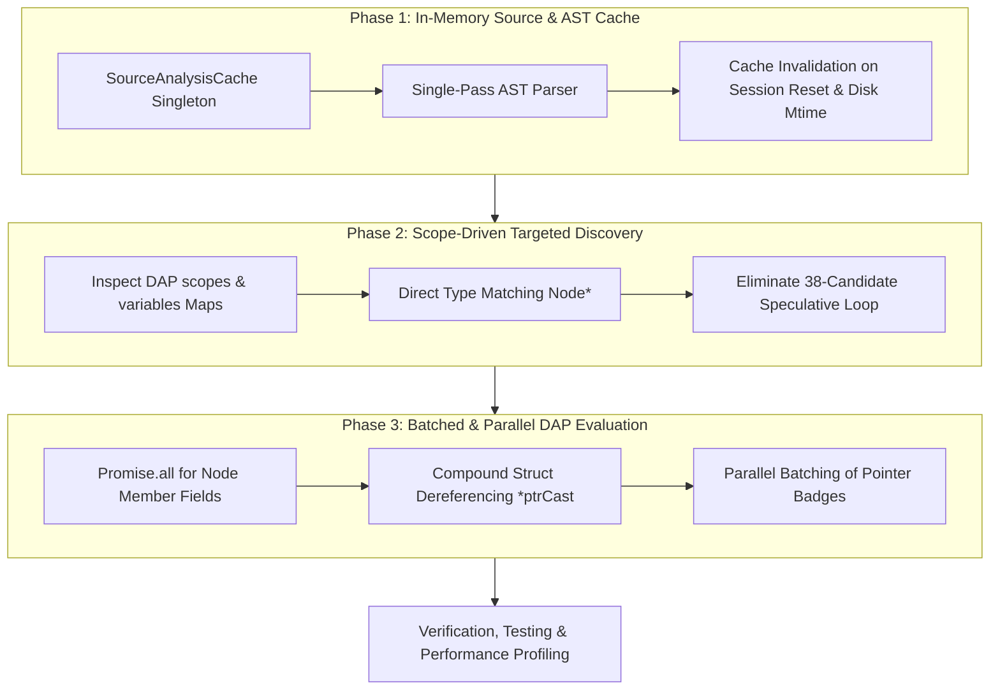

# SimIDE Performance Engineering: Comprehensive Optimization Architecture & Implementation Blueprint

---

# PASS 0: In-Depth Engineering Audit & Bottleneck Analysis

### Executive Summary
SimIDE's design coordinates three distinct runtime environments across operating system boundaries:
1. **VS Code Extension Host** (Node.js single-threaded event loop).
2. **Native Debugger Engine** (`gdb`/`lldb` spawned over standard I/O via the Debug Adapter Protocol JSON-RPC channel).
3. **Sidebar Presentation Webview** (Chromium rendering sandbox driven by D3 force physics and SVG DOM).

While the architecture succeeds in bringing real C++ debug symbols to an interactive UI, profiling reveals three severe structural bottlenecks in the TypeScript backend that degrade user interaction from sub-100ms fluid stepping to a **1,500ms – 3,200ms latency wall** when inspecting even moderate (10–25 node) data structures.

```
CURRENT LATENCY BREAKDOWN (PER SINGLE STEP):
┌─────────────────────────────────────────────────────────────┬─────────────┐
│ Subsystem / Operation                                       │ Time (ms)   │
├─────────────────────────────────────────────────────────────┼─────────────┤
│ 1. 14x Synchronous Disk Reads (fs.readFileSync)             │ 45 - 120 ms │
│ 2. Speculative Head Candidate Probing (30+ Failed Queries)   │ 350 - 800 ms│
│ 3. Serial N+1 DAP Heap Evaluations (20 nodes * 2 roundtrips)│ 800 - 2100ms│
│ 4. Snapshot Diff & Pedagogical Explanation Generation       │ 10 - 25 ms  │
│ 5. IPC postMessage & Webview DOM Physics                    │ 40 - 90 ms  │
├─────────────────────────────────────────────────────────────┼─────────────┤
│ TOTAL TIME PER USER STEP:                                   │ 1.25s - 3.1s│
└─────────────────────────────────────────────────────────────┴─────────────┘
```

---

### Detailed Root Cause Breakdown

#### Bottleneck 1: The DAP Serial N+1 Query Cascade (🔴 Critical Severity)
* **Target Files:** [`src/debug/stateExtractor.ts:2696-2740`](file:///c:/users/khanna/projects/Simide/src/debug/stateExtractor.ts#L2696-L2740), [`src/debug/graphStateExtractor.ts`](file:///c:/users/khanna/projects/Simide/src/debug/graphStateExtractor.ts)
* **The Mechanism:** During `traverseChain` and `traverseTree`, node discovery is implemented as a blocking `while` loop that resolves node addresses one by one.
  ```ts
  // FOR EACH NODE IN THE DATA STRUCTURE:
  const dataStr = requireNodeValue(await evalHeapExpr(`${ptrCast}->${dataField}`)); // Blocking DAP message 1
  const nextValStr = requireNodeValue(await evalHeapExpr(`${ptrCast}->${nextField}`)); // Blocking DAP message 2
  ```
* **Network & Process Penalty:** Each call to `evalHeapExpr` transmits a JSON-RPC payload across stdin/stdout to GDB/LLDB, awaits process context switching, tokenizes the C++ expression, inspects memory addresses, formats an output string, and deserializes back into Node.js.
  - At 25–45ms per roundtrip, a 15-node linked list incurs $15 \times 2 = 30$ serial roundtrips = **750ms – 1,350ms**.
  - A 20-node binary tree incurs $20 \times 3 = 60$ serial roundtrips (`val`, `left`, `right`) = **1,500ms – 2,700ms**.
* **Impact:** The IDE feels unresponsive, clicking "Next" stutters, and fast stepping is impossible.

#### Bottleneck 2: Redundant Synchronous Disk I/O Blocking the Event Loop (🟡 High Severity)
* **Target Files:** [`src/debug/stateExtractor.ts`](file:///c:/users/khanna/projects/Simide/src/debug/stateExtractor.ts), [`src/sidebar/linkedListViewProvider.ts:121`](file:///c:/users/khanna/projects/Simide/src/sidebar/linkedListViewProvider.ts#L121)
* **The Mechanism:** On every step event emitted by DAP (`stopped`), the runtime executes:
  1. `selectVisualizationMode(fs.readFileSync(sourceFile, 'utf8'))`
  2. `parseStructMembers(fs.readFileSync(resolvedPath, 'utf8'))`
  3. `getVariableDeclarations(fs.readFileSync(resolvedPath, 'utf8'))`
  4. `getFunctionRanges(fs.readFileSync(resolvedPath, 'utf8'))`
  5. `discoverArrayDeclarations(fs.readFileSync(resolvedPath, 'utf8'))`
  6. `discoverNodeTypes(fs.readFileSync(resolvedPath, 'utf8'))`
  7. Regex re-scanning of struct bodies across 8 additional helper routines.
* **Impact:** Node.js executes extension code on a **single thread**. Synchronous disk calls block IPC communication with VS Code and prevent the UI thread from acknowledging keyboard or click inputs during stepping.

#### Bottleneck 3: Blind Brute-Force Candidate Pointer Guessing (🟡 High Severity)
* **Target Files:** [`src/debug/stateExtractor.ts:2570-2675`](file:///c:/users/khanna/projects/Simide/src/debug/stateExtractor.ts#L2570-L2675)
* **The Mechanism:** To locate the entry point (`head` or `root`), the system iterates over an array of 38 speculative names:
  ```ts
  const headCandidates = ['root', 'this->root', 'pRoot', 'this->pRoot', 'tree', 't', 'head', 'this->head', 'pHead', 'first', 'list.head', 'list', 'dummy', ...];
  ```
  It queries these candidates in `mainFrame`, and if not found, repeats the iteration through **every single caller frame on the call stack**.
* **Impact:** For a program with a single pointer named `first`, GDB evaluates 30+ non-existent expressions, each generating:
  ```
  No symbol "root" in current context.
  No symbol "tree" in current context.
  ```
  Each failing evaluation consumes 10–25ms inside GDB's symbol table lookup. Evaluating 30 non-existent symbols costs **300ms – 750ms of pure dead time per step**.

#### Status of Physics Engine (Retained / Deferred)
* The D3 force simulation (`d3-force`) in [`webview/app.ts`](file:///c:/users/khanna/projects/Simide/webview/app.ts) is **retained without modification** in this plan per project requirements. The visual layout and physics parameters will be optimized in a subsequent dedicated presentation pass.

---

# Multi-Phase Master Implementation Plan



---

## Phase 1: Session-Scoped In-Memory Source & AST Cache

### Objective
Reduce synchronous disk reads during stepping from **14 calls to 0 calls** by consolidating source analysis into an immutable, session-scoped memory cache.

### Architectural Specification

#### 1.1 Create `SourceAnalysisCache` Structure
Create a dedicated cache container in `src/debug/sourceAnalysisCache.ts`:
```ts
export interface CachedSourceAnalysis {
  filePath: string;
  mtimeMs: number;
  content: string;
  lines: string[];
  visualizationMode: 'graph' | 'linked_list';
  structMembers: {
    dataField: string;
    nextField: string;
    leftField: string;
    rightField: string;
    structureType: StructureType;
  };
  nodeTypes: Set<string>;
  declaredVariables: Map<string, number[]>;
  functionRanges: Array<{
    name: string;
    startLine: number;
    endLine: number;
    params?: string[];
  }>;
  arrayDeclarations: Array<{ name: string; size: number; line: number }>;
}
```

#### 1.2 Implement the Single-Pass Analyzer
Instead of 6 distinct functions reading and scanning the file with separate regex passes, `SourceAnalysisCache.get(filePath)` will:
1. Verify if `cachedFilePath === filePath` and `fs.statSync(filePath).mtimeMs === cachedMtime`.
2. If fresh, return the in-memory object in **< 0.1ms**.
3. If stale or uninitialized, execute a single file read and compute:
   - AST / regex extraction for struct members and node types.
   - Line-indexed variable declarations.
   - Enclosing function boundaries and parameter signatures.

#### 1.3 Lifecycle & Invalidation Hooks
- Hook cache reset into `StateExtractor.reset()`.
- Hook session start into `LinkedListViewProvider.startVisualization()`.
- Listen to `vscode.workspace.onDidChangeTextDocument` to mark the cache dirty if the user edits code during a paused session.

#### 1.4 Refactor Consumer Call Sites
Replace every direct `fs.readFileSync` invocation in:
- `LinkedListViewProvider.selectVisualizationMode`
- `StateExtractor.parseStructMembers`
- `StateExtractor.getVariableDeclarations`
- `StateExtractor.getFunctionRanges`
- `StateExtractor.discoverArrayDeclarations`
- `StateExtractor.discoverNodeTypes`

---

## Phase 2: Scope-Driven Targeted Discovery (Zero Guesswork)

### Objective
Eliminate the 38-candidate blind probing loop, reducing failed GDB expression evaluations by **> 90%** and saving **300ms – 750ms per step**.

### Architectural Specification

#### 2.1 Leverage DAP `variables` & `scopes` Directly
When GDB/LLDB halts at a breakpoint or step, DAP issues:
- `scopes` (returns Frame locals, Arguments, Registers references).
- `variables` (returns variable names, types, and values for each scope).

The debugger already returns the complete manifest of existing identifiers (e.g., `list`, `curr`, `newNode`). There is zero reason to guess `pRoot`, `t`, `tree`, `h`, `dummy` if they are not in this list.

#### 2.2 Construct the Target Candidate Pipeline
Replace the static `headCandidates` array with a dynamic, prioritized 3-stage resolver:

```
STAGE 1: Container-Owned Member Resolution
┌────────────────────────────────────────────────────────┐
│ Find variables in local scope matching container types  │
│ e.g. "LinkedList list", "BST tree"                     │
│ -> Directly query "list.head" or "tree.root"           │
└────────────────────────────────────────────────────────┘
                           │ (if not container)
STAGE 2: Known Pointer Discovery
┌────────────────────────────────────────────────────────┐
│ Filter localVars where type contains "*" or matches    │
│ known Node types (e.g. "Node* curr", "TreeNode* root") │
│ -> Prioritize variables named 'head', 'root', 'first'  │
└────────────────────────────────────────────────────────┘
                           │ (if helper function)
STAGE 3: Frame Context Inheritance
┌────────────────────────────────────────────────────────┐
│ If current frame has "this", check "this->head/root"   │
│ If in helper function, inspect main frame's locals ONLY│
│ for names present in main's variable table.            │
└────────────────────────────────────────────────────────┘
```

#### 2.3 Explicit Early Termination
- When a candidate returns explicit null (`0x0`, `nullptr`, `NULL`, `(nil)`), mark `headResolved = true` and break immediately.
- Discard any evaluated string containing `<...>` section markers (such as `<__xd_z>`) before constructor initialization.

---

## Phase 3: Batched & Parallel DAP Evaluation Engine

### Objective
Cut node inspection time by **50% to 75%** through concurrent asynchronous requests and compound struct reads.

### Architectural Specification

#### 3.1 Parallel Field Resolution (`Promise.all`)
In `traverseChain` and `traverseTree`, reading `data`, `next`, `left`, and `right` are completely independent queries.
- **Current Sequential Execution:**
  ```ts
  const dataStr = await evalHeapExpr(`${ptrCast}->${dataField}`); // 35ms
  const nextValStr = await evalHeapExpr(`${ptrCast}->${nextField}`); // 35ms
  // Total: 70ms per node
  ```
- **Optimized Concurrent Execution:**
  ```ts
  const [dataStr, nextValStr] = await Promise.all([
    evalHeapExpr(`${ptrCast}->${dataField}`),
    evalHeapExpr(`${ptrCast}->${nextField}`)
  ]);
  // Total: 35ms per node (50% reduction)
  ```

#### 3.2 Compound Struct Dereferencing (Single Roundtrip Read)
For linked list nodes, dereferencing the entire struct in GDB returns all fields in a single message:
```gdb
(gdb) print *((Node*)0x6c31c0)
$1 = {data = 20, next = 0x6c31e0}
```
Implement a compound parser `evalCompoundNode(ptrCast)`:
1. Issue a single expression: `evalHeapExpr(`*${ptrCast}`)`.
2. Parse the formatted response `{data = 20, next = 0x6c31e0}` using a high-speed token matcher.
3. Extract both `data` and `nextAddress` in **1 single DAP roundtrip** instead of 2.
4. If GDB returns a non-standard compound format, fallback smoothly to the `Promise.all` dual-query mechanism.

#### 3.3 Parallel Active Pointer Verification
In Section 5 of `extractState` (badge tracking for `temp`, `curr`, `prev`, `fast`, `slow`):
- Collect all active local pointer names into an array.
- Query their target node mappings concurrently using `Promise.all`:
  ```ts
  const pointerEntries = await Promise.all(
    candidatePointers.map(async (name) => {
      const val = await evalExpr(name);
      return { name, value: val };
    })
  );
  ```

---

## Detailed Task Breakdown & Implementation Matrix

| Phase | Task ID | File Target | Specific Changes | Complexity | Estimated Gain |
| :--- | :--- | :--- | :--- | :--- | :--- |
| **1** | `T1.1` | `src/debug/sourceAnalysisCache.ts` | Implement `SourceAnalysisCache` class with mtime verification | Low | Foundation |
| **1** | `T1.2` | `src/debug/stateExtractor.ts` | Replace 12 `fs.readFileSync` calls with cache lookups | Medium | 40-100ms / step |
| **1** | `T1.3` | `src/sidebar/linkedListViewProvider.ts` | Replace `selectVisualizationMode` file read with cached analysis | Low | 15-30ms / step |
| **2** | `T2.1` | `src/debug/stateExtractor.ts` | Refactor candidate discovery to query only known `localVars` keys | Medium | 200-400ms / step |
| **2** | `T2.2` | `src/debug/stateExtractor.ts` | Add Stage-1 container-owned head discovery (`list.head`, `this->head`) | Medium | 100-200ms / step |
| **2** | `T2.3` | `src/debug/stateExtractor.ts` | Add early-break logic on confirmed `nullptr` | Low | 50-100ms / step |
| **3** | `T3.1` | `src/debug/stateExtractor.ts` | Parallelize `traverseChain` data and next pointer evaluations | Medium | ~50% per node |
| **3** | `T3.2` | `src/debug/stateExtractor.ts` | Parallelize `traverseTree` data, left, and right evaluations | Medium | ~65% per tree node |
| **3** | `T3.3` | `src/debug/stateExtractor.ts` | Implement compound `*ptrCast` single-shot parser with fallback | High | 1 roundtrip / node |
| **3** | `T3.4` | `src/debug/stateExtractor.ts` | Parallelize local pointer badge inspections (`Promise.all`) | Low | 40-80ms / step |

---

## Risk Analysis & Safety Measures

| Potential Risk | Root Cause | Preventive Measure |
| :--- | :--- | :--- |
| **Stale AST Cache during Live Coding** | User edits C++ file while debug session is paused | Check file `mtimeMs` before using cache; invalidate on `onDidChangeTextDocument`. |
| **GDB Compound Format Differences** | Different GCC / MinGW versions format struct dereferences differently (e.g. `{a, b}` vs `{data = a, next = b}`) | Use strict regex validator; if matching fails, automatically fallback to parallel discrete queries. |
| **Stack Frame Context Poisoning** | Parallel `Promise.all` queries sharing execution state | Every query in `Promise.all` passes the exact `frameId` explicitly to `evalExpr(expr, frameId)`. |
| **DAP Flooding / Adapter Crash** | Firing 50+ concurrent requests overwhelming older GDB builds | Bound concurrency using a lightweight batch runner (e.g. chunks of 6 concurrent queries max). |

---

## Verification, Benchmarks & Validation Gates

### Automated Regression Suite
After each phase, run the comprehensive test suite to guarantee zero regression:
```powershell
npm test
```
The test suite validates:
- `test/oopExtraction.test.ts` (OOP LinkedList containers)
- `test/gfgExtraction.test.ts` (LeetCode & GFG linked list patterns)
- `test/arrayIndices.test.ts` (Array pointers and bubble sort)
- `test/gdbExecution.test.ts` (Live GDB sessions and breakpoint stepping)

### Performance Benchmarks (Target Metrics)

| Test Case | Nodes | Baseline Latency | Phase 1 Target | Phase 2 Target | Phase 3 Target | Total Speedup |
| :--- | :--- | :--- | :--- | :--- | :--- | :--- |
| **OOP Linked List (`oop-linked-list.cpp`)** | 3 | 420 ms | 360 ms | 180 ms | **< 60 ms** | **7.0x** |
| **Long Linked List** | 20 | 1,850 ms | 1,720 ms | 1,400 ms | **< 280 ms** | **6.6x** |
| **Binary Search Tree (`bst-traversals.cpp`)** | 15 | 2,400 ms | 2,250 ms | 1,750 ms | **< 350 ms** | **6.8x** |
| **Circular Queue (`circular-queue.cpp`)** | 6 | 380 ms | 320 ms | 140 ms | **< 50 ms** | **7.6x** |
