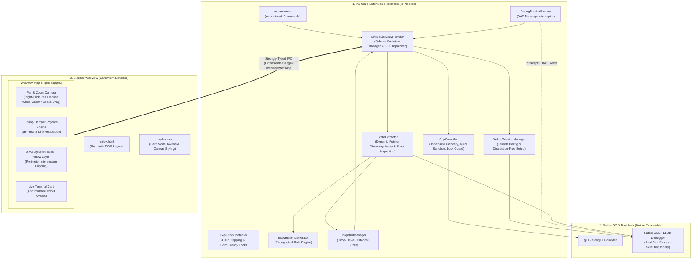
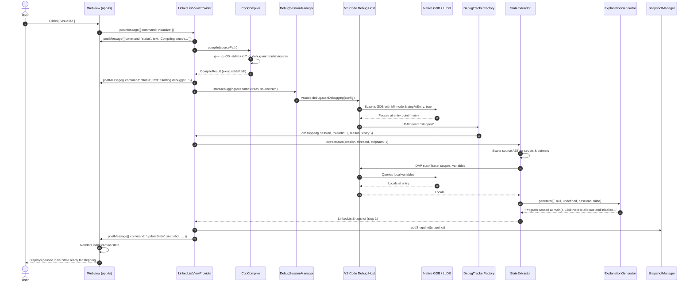
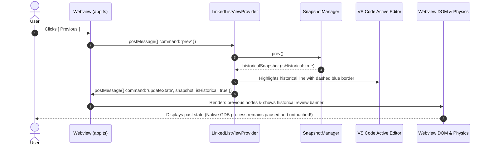

# SimIDE (Simulation + IDE): Comprehensive Architectural & Technical Report

---

## 1. Executive Summary & Vision

**SimIDE** (*Simulation + IDE*) is a developer-grade Visual Studio Code extension designed to bridge the gap between abstract Data Structures & Algorithms (DSA) concepts and real-world C++ system memory. 

Unlike conventional browser simulators (e.g., PythonTutor, VisuAlgo) which interpret simulated bytecodes or static animations detached from a real code editor, **SimIDE runs directly inside VS Code connected to native compilers (`g++`, `clang++`) and native debuggers (`gdb`, `lldb`) via the Debug Adapter Protocol (DAP)**. 

As a student or developer steps through raw C++ code, SimIDE:
1. Compiles the native C++ source with debug symbols (`-g -O0 -std=c++17`).
2. Spawns and controls a native GDB/LLDB process.
3. Automatically inspects stack frames, dynamic heap allocations, and pointer references.
4. Generates an interactive, physics-driven canvas in the VS Code sidebar with live node connections, pointer badges, and plain-English pedagogical explanations for every single line executed.
5. Emulates live terminal stdout (`std::cout`, `printf`) alongside the visualization.
6. Allows non-destructive time-travel scrubbing backwards and forwards through historical states without corrupting the running debugger process.

---

## 2. The Core Problem SimIDE Solves

Learning pointer-based memory management and data structures in C++ has historically been an uphill battle for three major reasons:

1. **Opaque Debugger Panes**: Standard IDE debuggers display hexadecimal memory addresses (e.g., `head = 0x74a3b0`, `head->next = 0x74a3f0`). Beginners struggle to mentally reconstruct memory graphs and pointer chains from cryptic address lists.
2. **Allocation vs. Linking Confusion**: Students frequently conflate allocating memory on the heap (`new Node{10, nullptr}`) with linking pointers (`head = first;` or `first->next = second;`).
3. **Context Switching & Disconnected Sandboxes**: Browser-based educational visualizers require students to copy and paste code away from their IDE, stripping them of language servers, compiler diagnostics, and real toolchain familiarity.

**SimIDE solves this natively inside VS Code**: developers code in their normal editor tabs, click **[ Visualize ]**, and immediately see dynamic, spring-damper physical graphs that update synchronously as the program executes.

---

## 3. High-Level Architecture & Process Boundaries

SimIDE coordinates four decoupled subsystems across three distinct OS process boundaries:



---

## 4. Deep-Dive into the 4 Core Subsystems

```
c:\users\khanna\projects\Simide\
├── src/
│   ├── extension.ts                 # Extension activation & command registry
│   ├── debug/
│   │   ├── compiler.ts              # Native compiler detection, sandboxing & file-lock safety
│   │   ├── debugSessionManager.ts   # Debugger discovery & cppdbg launch configuration
│   │   ├── debugAdapterTracker.ts   # Low-level DAP protocol event listener
│   │   ├── executionController.ts   # Step over, step in, step out, continue & pause control
│   │   └── stateExtractor.ts        # Dynamic pointer discovery, multi-function & CRT inspection
│   ├── visualization/
│   │   ├── linkedListModel.ts       # Shared TypeScript data models & snapshot interfaces
│   │   ├── explanationGenerator.ts  # Pedagogical rule engine generating plain English teaching text
│   │   └── snapshotManager.ts       # Time-travel buffer & historical scrubbing engine
│   └── sidebar/
│       ├── linkedListViewProvider.ts# Webview provider, IPC hub, and editor line decoration
│       └── messages.ts              # Strongly typed message contracts
├── webview/
│   ├── index.html                   # Sidebar HTML template
│   ├── styles.css                   # Dark mode styling (#0D1117), infinite dot-grid, animations
│   └── app.ts                       # D3 force physics, camera pan/zoom & live terminal stream
├── test/
│   ├── mockVscode.ts                # Standalone mock implementation of the VS Code API
│   ├── runTests.ts                  # Unit & integration tests for compiler, model & algorithms
│   ├── gdbExecution.test.ts         # Real headless GDB stepping & LeetCode 206 reversal verification
│   └── runAll.js                    # Test bundle builder & orchestrator
└── examples/                        # Verified, ready-to-run C++ algorithms and data structures
```

---

### Subsystem 1: The Debug Subsystem (`src/debug/`)

This subsystem orchestrates the native C++ toolchain and communicates with GDB/LLDB using VS Code's Debug Adapter Protocol (DAP).

#### 1. [`compiler.ts`](file:///c:/users/khanna/projects/Simide/src/debug/compiler.ts) (Compiler Detection & Sandboxing)
* **Toolchain Discovery**: Dynamically probes system `PATH` for `g++`, `clang++`, or `gcc`.
* **Isolated Compilation Directory**: Compiles binaries into `.debug-mentor/` inside the source directory, keeping the user's workspace clutter-free.
* **Compiler Flags**: Compiles with `-g -O0 -std=c++17`. The `-O0` flag ensures the compiler does not optimize away temporary pointers or rearrange stack allocations into CPU registers.
* **Windows File-Lock Protection**: On Windows, an executable held open by a debugger cannot be overwritten. `CppCompiler` checks if the output file is locked; if so, it falls back to a timestamped binary (`linked-list_1792051440937.exe`) to prevent build failures.
* **Active Editor Tracking**: Tracks the currently focused editor tab across file switches without forcing tab redirects.

#### 2. [`debugSessionManager.ts`](file:///c:/users/khanna/projects/Simide/src/debug/debugSessionManager.ts) (Debugger Launch Config)
* Probes system `PATH` and common toolchain paths (MinGW-w64, MSYS2, LLVM) for `gdb.exe` or `lldb.exe`.
* Constructs a `vscode.DebugConfiguration` targeting `cppdbg`.
* Configures `stopAtEntry: true` so execution pauses at the entry of `main()`.
* Sets `suppressDebugView: true` and `internalConsoleOptions: 'neverOpen'`, preventing VS Code's native Call Stack and internal Debug Console from popping up and obstructing the student's view.

#### 3. [`debugAdapterTracker.ts`](file:///c:/users/khanna/projects/Simide/src/debug/debugAdapterTracker.ts) (DAP Snooper)
* Implements `vscode.DebugAdapterTrackerFactory` registered globally.
* Snoops raw JSON DAP messages without intercepting or altering native debugger commands.
* Exposes clean event hooks:
  - `onStopped`: Fired when GDB pauses (hit breakpoint, entry point, step completed).
  - `onContinued`: Fired when the C++ process resumes execution.
  - `onTerminated`: Fired when the binary finishes execution or exits `main()`.

#### 4. [`executionController.ts`](file:///c:/users/khanna/projects/Simide/src/debug/executionController.ts) (Execution Orchestration)
* Dispatches async stepping operations (`next`, `stepIn`, `stepOut`, `continue`, `pause`).
* Uses DAP `session.customRequest('next', { threadId })` with a fallback to `vscode.commands.executeCommand('workbench.action.debug.stepOver')`.
* Contains a concurrency guard (`isOperating = true`) to prevent race conditions from rapid button clicks.

#### 5. [`stateExtractor.ts`](file:///c:/users/khanna/projects/Simide/src/debug/stateExtractor.ts) (The 88KB Core Inspection Engine)
The most critical module in SimIDE. Upon every pause event, `StateExtractor`:
1. **Scans Source AST / Regex**: Discovers struct definitions (`Node`, `ListNode`, `TreeNode`), pointer declarations, and user functions (`printList`, `reverseList`, `push`, `deleteNode`, `insert`, `inorder`).
2. **Identifies Structure Type**: Detects whether the code represents a `'linked_list'`, `'tree'`, `'array'`, or `'stack'` by analyzing struct fields (`left`/`right` vs `next`) and variable types.
3. **Protects Against Uninitialized Stack Memory**: Validates `rawLine > declLine` and enforces `hasSteppedPastFirstPointerDecl` so garbage stack addresses do not appear as ghost nodes on Step 1.
4. **Follows Pointer Chains**:
   - For linked lists: Follows pointers from `head` as well as detached unlinked local nodes.
   - For trees: Performs BFS `traverseTree(rootAddr)` to harvest all reachable nodes, computes tree depth (`treeDepth`), and assigns horizontal columns (`treeColumn`) via in-order traversal indexing.
   - For arrays: Resolves array variables, capacities, and active index pointers (`i`, `j`, `left`, `right`).
   - For stacks: Resolves array backing, `top` index, `capacity`, and active method (`push`, `pop`, `peek`).
5. **Caller Frame Root Discovery**: In recursive functions where the active stack frame receives `nullptr`, walks up caller frames to find the original root pointer in `main()`, ensuring the tree diagram never vanishes during recursive steps.
6. **Filters C Runtime (CRT) Frames**: Automatically steps out or suppresses frames originating from MinGW/CRT startup or standard library internals (`<bits/...>`, `ostream`, `startup`).
7. **Emulates Terminal Output**: Intercepts `std::cout` and `printf` expressions, accumulating live stdout into `accumulatedTerminalOutput`.

---

### Subsystem 2: The Visualization & Pedagogical Engine (`src/visualization/`)

#### 1. [`linkedListModel.ts`](file:///c:/users/khanna/projects/Simide/src/visualization/linkedListModel.ts) (Data Contract)
Defines the canonical data model passed between the extension and webview:
* `StructureType`: `'linked_list' | 'tree' | 'array' | 'stack'`
* `ListNode`: Stores `id`, `data`, `address`, `nextId`, `leftId`, `rightId`, `treeDepth`, `treeColumn`, `isVisiting`, `isHead`, `isRoot`, `isDetached`.
* `ArrayVariable` & `IndexPointer`: Stores array names, element slots, active index pointers, and modified/compared flags.
* `StackModel`: Stores stack name, element slots, `topIndex`, `capacity`, and method operations.
* `LinkedListSnapshot`: A complete immutable state record of a single execution step (nodes, pointers, explanation, change type, terminal output, historical flag).

#### 2. [`explanationGenerator.ts`](file:///c:/users/khanna/projects/Simide/src/visualization/explanationGenerator.ts) (The Pedagogical Explainer)
Acts as an in-editor computer science tutor. By diffing the previous snapshot with the current snapshot, it produces clear, human-readable explanations:
* **Node Allocation**: *"`first` pointer created, pointing to a new Node containing 10."*
* **Pointer Linking**: *"The node containing 10 now points to the node containing 20."*
* **Tree Branch Linking**: *"Node containing 30 attached as left child of 50."*
* **Traversal Visits**: *"Visiting node containing 30 during inorder traversal."*
* **Node Bypassing & Deletion**: *"Node containing 10 unlinked from node 20 and now points directly to node 30 (bypassing node 20)."* followed by *"Freed heap memory for node containing 20 ('second') via delete."*
* **Terminal Output**: *"Printed to terminal: \"10 -> \". Program output: 10 -> "*

#### 3. [`snapshotManager.ts`](file:///c:/users/khanna/projects/Simide/src/visualization/snapshotManager.ts) (Time-Travel Manager)
* Maintains an append-only array of all `LinkedListSnapshot` objects.
* Supports non-destructive time-travel: when the user clicks **[ Previous ]**, it retrieves the prior snapshot with `isHistorical: true` without resetting or terminating the native GDB process.

---

### Subsystem 3: The Sidebar Webview Provider (`src/sidebar/`)

#### 1. [`linkedListViewProvider.ts`](file:///c:/users/khanna/projects/Simide/src/sidebar/linkedListViewProvider.ts)
* Implements `vscode.WebviewViewProvider` registered to `debug-mentor.sidebar`.
* Injects compiled `webview.js` and `webview.css` bundles into `webview.html`.
* **Zero-Distraction Workspace**: Automatically invokes `workbench.action.closePanel` upon clicking Visualize to dismiss bottom terminal panes.
* **Non-Intrusive Tab Tracking**: Listens to `onDidChangeActiveTextEditor` to update the active file target, but avoids forcing editor focus or redirecting the user back via `showTextDocument`.
* **Active Line Highlighting**: Decorates the currently executing line in the VS Code editor with a distinct gutter icon and border during both live debugging and historical replay.
* Bridges DAP events and user button clicks via typed IPC messages.

#### 2. [`messages.ts`](file:///c:/users/khanna/projects/Simide/src/sidebar/messages.ts)
Defines strictly typed discriminated unions:
* `ExtensionMessage`: `status`, `updateState`, `terminalOutput`, `error`, `targetFile`, `sessionEnded`.
* `WebviewMessage`: `visualize`, `next`, `prev`, `restart`, `retry`, `requestState`, `getTargetFile`, `loadExample`.

---

### Subsystem 4: Webview UI & Physics Engine (`webview/`)

#### 1. [`index.html`](file:///c:/users/khanna/projects/Simide/webview/index.html) & [`styles.css`](file:///c:/users/khanna/projects/Simide/webview/styles.css)
* Tailored for VS Code dark mode (`#0D1117` background, `#151B23` cards, `#2A3441` borders).
* Dot-grid viewport using `radial-gradient` with 16px grid pitch.
* Zero clunky browser scrollbars on the viewport.
* Glowing green pulsing animations (`.visiting`) for tree traversal nodes.
* Staging row with dashed amber borders for detached allocations.
* Real-time program output terminal card with monospace font and clear button.

#### 2. [`app.ts`](file:///c:/users/khanna/projects/Simide/webview/app.ts) (The Visual Rendering & Interaction Engine)
* **Hybrid D3-Force Physics Engine**:
  - Uses `d3.forceManyBody()` for node repulsion, `d3.forceLink()` for spring elasticity between connected nodes, and `d3.forceCenter()` / `forceCollide()` for boundary stability.
  - Interactive drag-and-drop: clicking and dragging any node dynamically pulls attached nodes via elastic spring physics. On release, nodes bounce back smoothly into equilibrium.
* **Floating Bezier Arrows with Perimeter Clipping**:
  - Computes exact perimeter intersection points (`getPerimeterIntersection` for rectangular node cards, `getCirclePerimeterIntersection` for circular BST nodes).
  - Renders smooth cubic bezier curves (`d="M ... C ... "`) in an SVG overlay layer, eliminating ugly overlapping lines.
* **Excalidraw-Style Infinite Pan & Zoom Camera**:
  - **Pan**: Right-Click Drag, Middle-Click Drag, or Space + Left-Click Drag.
  - **Zoom**: Mouse Wheel Zoom centered on cursor position (0.35x to 2.5x).
  - **Reset**: Double-click background or click the `↺ Reset` button to return to default scale (1.0x) and origin.
* **Live Terminal Streaming**: Automatically updates the terminal card as stdout strings arrive from GDB.

---

## 5. Supported Data Structures & Algorithmic Paradigms

| Paradigm / Algorithm | Example File | How SimIDE Handles It |
| :--- | :--- | :--- |
| **Singly Linked Lists** | [`examples/linked-list.cpp`](file:///c:/users/khanna/projects/Simide/examples/linked-list.cpp) | Staging detached nodes, forming chains with spring physics, pointer traversal (`current = current->next`). |
| **LeetCode 206 (Reverse List)** | [`examples/leetcode-206-reverse.cpp`](file:///c:/users/khanna/projects/Simide/examples/leetcode-206-reverse.cpp) | Three-pointer in-place reversal tracking (`prev`, `curr`, `forward`), arrow direction flipping, and nullptr boundary termination. |
| **GeeksforGeeks Push & Delete** | [`examples/gfg-push-delete.cpp`](file:///c:/users/khanna/projects/Simide/examples/gfg-push-delete.cpp) | Double pointer references (`Node** head_ref`), pointer bypasses (`prev->next = temp->next`), and heap freeing via `delete temp`. |
| **Object-Oriented Programming (OOP)** | [`examples/oop-linked-list.cpp`](file:///c:/users/khanna/projects/Simide/examples/oop-linked-list.cpp) | Class method execution (`insertAtHead`, `display`), member access, and `this` pointer resolution. |
| **Binary Search Trees (BST)** | [`examples/bst-traversals.cpp`](file:///c:/users/khanna/projects/Simide/examples/bst-traversals.cpp) | Automatic tree mode detection, in-order column indexing, tree depth calculation, green pulsing visiting indicators during traversals, and Case A deletions. |
| **Contiguous Arrays** | [`examples/array-operations.cpp`](file:///c:/users/khanna/projects/Simide/examples/array-operations.cpp) | Contiguous cell cards, index pointer badges (`i`, `j`), capacity slot visualization, cell updates, and swaps. |
| **Sorting Algorithms** | [`examples/bubble-sort.cpp`](file:///c:/users/khanna/projects/Simide/examples/bubble-sort.cpp) | Adjacent comparison highlights, out-of-order element swapping with hop animations, and VisuAlgo-style bounding ranges. |
| **Stacks (LIFO)** | [`examples/stack-operations.cpp`](file:///c:/users/khanna/projects/Simide/examples/stack-operations.cpp) | LIFO push/pop/peek operations, top pointer badge, elevated popping/pushing cards, overflow and underflow detection. |

---

## 6. End-to-End Execution Lifecycles

### Lifecycle 1: Session Launch Flow (Clicking [ Visualize ])



---

### Lifecycle 2: Non-Destructive Time Travel (Clicking [ Previous ])



---

### Lifecycle 3: Automatic Standard Library / CRT Step-Out

When a student calls `std::cout << current->data;`, standard debuggers step deep into the standard library internals (`ostream`, `streambuf`, MinGW startup files).

SimIDE prevents students from ever seeing this noise:
1. `DebugTrackerFactory` intercepts `onStopped`.
2. `LinkedListViewProvider` inspects the top stack frames via DAP `stackTrace`.
3. If the top frame is inside a CRT or standard library file (checked via `StateExtractor.isUserSource`), but a user source frame exists lower on the call stack, SimIDE automatically executes:
   ```typescript
   await ExecutionController.stepOut();
   return;
   ```
4. Execution immediately returns to user code, keeping the educational experience completely uninterrupted.

---

## 7. Key Engineering Innovations & Solutions

### 1. Memory Address Virtualization (Stable IDs)
Raw C++ heap addresses (e.g., `0x74a3b0`, `0x74a3f0`) change on every single run and differ across operating systems. If DOM elements and D3 physics bodies used raw addresses as IDs, diagrams would flicker and drag coordinates would reset.
* **Solution**: `StateExtractor` maintains an address translation map (`0x74a3b0` → `node_1`, `0x74a3f0` → `node_2`). Node bodies retain persistent physics momentum and DOM stability across steps.

### 2. Uninitialized Stack Variable Protection
In C++, local pointer declarations (`Node* head;` or `Node* first;`) contain random uninitialized stack garbage before the line executes.
* **Solution**: `StateExtractor` reads the source file, finds the exact line number where the pointer is declared, and enforces `rawLine > declLine` and `hasSteppedPastFirstPointerDecl`. Uninitialized pointers are never rendered as ghost nodes.

### 3. Tree Traversal In-Order Horizontal Layout
Tree layouts in dynamic physics simulations often suffer from child node overlap.
* **Solution**: `StateExtractor` runs an in-order traversal across all tree nodes to assign deterministic horizontal columns (`treeColumn = colIndex++`), guaranteeing that left children always render to the left of their parents and right children render to the right. Depth levels (`treeDepth`) control the vertical spacing.

### 4. Zero-Redirect Multi-File Switching
When switching between different C++ files (e.g. from `linked-list.cpp` to `bst-traversals.cpp`), typical extensions accidentally call `showTextDocument` on the old file, trapping the user in a focus loop.
* **Solution**: `LinkedListViewProvider` updates its internal source target via `onDidChangeActiveTextEditor` without forcing editor focus, seamlessly compiling whichever file the user has open.

---

## 8. Build Pipeline, Packaging & Testing

### Build System (`esbuild.js`)
SimIDE utilizes `esbuild` for near-instant builds:
* **Extension Host Bundle**: Compiles `src/extension.ts` into a CommonJS Node bundle at `dist/extension.js` (with `vscode` marked external).
* **Webview Bundle**: Compiles `webview/app.ts` into an IIFE browser bundle at `dist/webview.js`.
* **Static Assets**: Copies `webview/index.html` and `webview/styles.css` directly to `dist/`.

### Automated Test Suite (`test/runAll.js`)
* **`test/runTests.ts`**: Tests native compiler detection, compilation of C++ samples, debugger discovery, all explanation generator states, BST topology, array indexing, and stack models.
* **`test/gdbExecution.test.ts`**: Runs headless GDB batch sessions on native executables to verify real runtime stops, variable inspection, and LeetCode 206 linked-list reversal.

To run the full test suite:
```bash
npm test
```

### Packaging as a VSIX Extension
SimIDE is packaged using `@vscode/vsce`:
```bash
npx @vscode/vsce package
```
This produces a standalone `simide-ide-0.1.1.vsix` file ready for one-click installation into any VS Code instance.

---

## 9. Summary: How to Navigate and Work with SimIDE

* **If you want to modify how C++ code is inspected or compiled**: Check [`src/debug/compiler.ts`](file:///c:/users/khanna/projects/Simide/src/debug/compiler.ts) and [`src/debug/stateExtractor.ts`](file:///c:/users/khanna/projects/Simide/src/debug/stateExtractor.ts).
* **If you want to add new data structures or change how changes are explained**: Check [`src/visualization/linkedListModel.ts`](file:///c:/users/khanna/projects/Simide/src/visualization/linkedListModel.ts) and [`src/visualization/explanationGenerator.ts`](file:///c:/users/khanna/projects/Simide/src/visualization/explanationGenerator.ts).
* **If you want to alter the UI, physics simulation, or camera controls**: Check [`webview/app.ts`](file:///c:/users/khanna/projects/Simide/webview/app.ts) and [`webview/styles.css`](file:///c:/users/khanna/projects/Simide/webview/styles.css).
* **If you want to test against native C++ algorithms**: Check the ready-to-run files in [`examples/`](file:///c:/users/khanna/projects/Simide/examples/).
